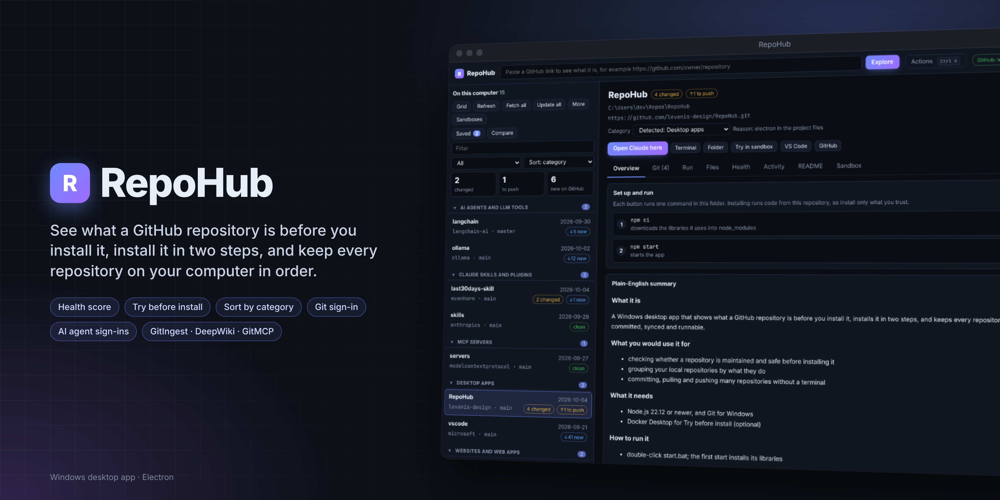

[](https://github.com/levanis-design/RepoHub)

# RepoHub AI Catalog

A practical English directory of AI tools, agent skills, models, and supporting resources, curated by Levani Sidiani. Find something useful, understand what it needs, and build a collection you can return to.

**[Explore the searchable catalog](https://levanis-design.github.io/repohub-ai-catalog/)** · [Suggest a project](https://github.com/levanis-design/repohub-ai-catalog/issues/new) · [Contribute](CONTRIBUTING.md) · [Download the dataset](dist/catalog.json)

**432 repositories · 2 reference guides · 21 categories · Metadata refreshed October 27, 2026**

**Stars reflect popularity, not quality or usefulness.** Smaller, newer, or niche projects can be worth exploring. Consider their fit, documentation, maintenance, and what they actually do. Counts of 1,000 or more are rounded up to whole thousands (K); exact counts remain in the dataset.

Includes the complete [AI Pulse Georgia collection](https://github.com/tornikebolokadze1-cyber/awesome-ai-pulse-georgia), merged with the curator's favorites, TradeDesk, and RepoHub. All 404 upstream entries are represented. Duplicate and renamed repositories are consolidated, while guides retain their original links. [Seed coverage](dist/coverage.json) and [upstream provenance](dist/catalog.json) record the source lists.

The cover shows the [RepoHub desktop app](https://github.com/levanis-design/RepoHub), the catalog's companion project.

## Categories

| Category | What you will find |
|---|---|
| [Coding Agents & AI IDEs](#category-coding-agents-ai-ides) | Coding assistants, AI editors, terminal agents, and autonomous software-development tools. |
| [Agent Orchestration](#category-agent-orchestration) | Coordinate agent teams, parallel sessions, and multi-agent workspaces. |
| [Skills, Plugins & Methodologies](#category-skills-plugins-methodologies) | Reusable agent skills, plugin collections, and structured development methods. |
| [Code Intelligence & Context](#category-code-intelligence-context) | Understand repositories through code graphs, semantic search, and documentation context. |
| [Tokens, Cost & LLM Gateways](#category-tokens-cost-llm-gateways) | Compress context, monitor model spending, and route requests between providers. |
| [Agent Frameworks & SDKs](#category-agent-frameworks-sdks) | Libraries and SDKs for building and running your own AI agents. |
| [MCP, Protocols & Integrations](#category-mcp-protocols-integrations) | Connect agents to external tools and services through MCP and related protocols. |
| [Web, Browser & Computer Use](#category-web-browser-computer-use) | Web search, scraping, browser automation, and desktop or mobile computer use. |
| [Memory, RAG & Documents](#category-memory-rag-documents) | Persistent memory, retrieval, vector storage, and document processing. |
| [Agent Infra: Sandboxes, Evals & Observability](#category-agent-infra-sandboxes-evals-observability) | Isolated execution, agent evaluation, tracing, and operational monitoring. |
| [AI Security](#category-ai-security) | AI-assisted security research, code auditing, and defenses for AI systems. |
| [Inference & Models](#category-inference-models) | Model inference engines, local model serving, training tools, and open models. |
| [No-Code & Workflow Builders](#category-no-code-workflow-builders) | Visual automation platforms, workflow builders, and their agent integrations. |
| [AI Assistants & Chat UIs](#category-ai-assistants-chat-uis) | Personal assistants, persistent bots, and interfaces for cloud or local models. |
| [Business & Work Agents](#category-business-work-agents) | Tools for office work, product management, marketing, CRM, and business analysis. |
| [Research & Education](#category-research-education) | Research assistants, learning tools, scientific workflows, and knowledge resources. |
| [Finance AI](#category-finance-ai) | Financial research, trading-agent infrastructure, financial data, and models. |
| [Design, UI & Diagrams](#category-design-ui-diagrams) | Interface design, visual feedback, diagramming, and creative-development tools. |
| [Media Generation](#category-media-generation) | Image and video generation, programmatic editing, and agent-led media production. |
| [Voice & Speech](#category-voice-speech) | Speech recognition, dictation, text-to-speech, and voice-agent tooling. |
| [Resources & Learning](#category-resources-learning) | Curated collections, practical guides, courses, and reference material. |

## Find a useful starting point

| Goal | Suggested starting points |
|---|---|
| Build and review a website | [gstack](https://github.com/garrytan/gstack), [Impeccable](https://github.com/pbakaus/impeccable), [Agentation](https://github.com/benjitaylor/agentation) |
| Research a current topic | [Last 30 Days](https://github.com/mvanhorn/last30days-skill), [Agent Reach](https://github.com/Panniantong/Agent-Reach) |
| Make a product video | [HyperFrames](https://github.com/heygen-com/hyperframes), [Brag](https://github.com/latent-spaces/brag), [Voicebox](https://github.com/jamiepine/voicebox) |
| Review a website's search visibility | [Claude SEO](https://github.com/AgriciDaniel/claude-seo), [Qiaomu SEO](https://github.com/joeseesun/qiaomu-seo) |
| Understand an unfamiliar repository | [Understand Anything](https://github.com/Egonex-AI/Understand-Anything), [RepoHub](https://github.com/levanis-design/RepoHub) |

These are editorial starting points, not claims of completed installation or workflow testing. The website includes three suggested workflows with steps and limitations.

## What the labels mean

- **Metadata reviewed:** the original GitHub description and repository facts were checked.
- **README reviewed:** the original project documentation was also read. 16 projects have this label. Other repositories are metadata-reviewed; reference guides are marked separately.
- **Experimental:** early-stage, small-adoption, or limited-history projects. This is not a quality score.
- **Related resource:** supporting software or research material that is not primarily an AI agent.
- **Curator project:** a repository maintained by this catalog's curator. Osiris is also explicitly identified as an upstream fork.

No project is currently labeled **Installation tested** or **Workflow tested**. Future testing labels require an environment, date, result, and limitations. Popularity is a dated snapshot, not evidence of quality. Requirements marked **See docs** or **Varies** need confirmation in the original setup guide.

## Complete collection

[Coding Agents & AI IDEs](#category-coding-agents-ai-ides) · [Agent Orchestration](#category-agent-orchestration) · [Skills, Plugins & Methodologies](#category-skills-plugins-methodologies) · [Code Intelligence & Context](#category-code-intelligence-context) · [Tokens, Cost & LLM Gateways](#category-tokens-cost-llm-gateways) · [Agent Frameworks & SDKs](#category-agent-frameworks-sdks) · [MCP, Protocols & Integrations](#category-mcp-protocols-integrations) · [Web, Browser & Computer Use](#category-web-browser-computer-use) · [Memory, RAG & Documents](#category-memory-rag-documents) · [Agent Infra: Sandboxes, Evals & Observability](#category-agent-infra-sandboxes-evals-observability) · [AI Security](#category-ai-security) · [Inference & Models](#category-inference-models) · [No-Code & Workflow Builders](#category-no-code-workflow-builders) · [AI Assistants & Chat UIs](#category-ai-assistants-chat-uis) · [Business & Work Agents](#category-business-work-agents) · [Research & Education](#category-research-education) · [Finance AI](#category-finance-ai) · [Design, UI & Diagrams](#category-design-ui-diagrams) · [Media Generation](#category-media-generation) · [Voice & Speech](#category-voice-speech) · [Resources & Learning](#category-resources-learning)

<a id="category-coding-agents-ai-ides"></a>

### Coding Agents & AI IDEs

| Repository | Stars | What it helps with |
|---|---:|---|
| [Aider](https://github.com/Aider-AI/aider) | 50K | aider is AI pair programming in your terminal<br><sub>Metadata reviewed</sub> |
| [avante.nvim](https://github.com/avante-corp/avante.nvim) | 19K | Use your Neovim like using Cursor AI IDE!<br><sub>Metadata reviewed</sub> |
| [Claude Code](https://github.com/anthropics/claude-code) | 154K | Claude Code is an agentic coding tool that lives in your terminal, understands your codebase, and helps you code faster by executing routine tasks, explaining complex code, and handling git workflows - all through natural language commands.<br><sub>Metadata reviewed</sub> |
| [Claude Code Action](https://github.com/anthropics/claude-code-action) | 10K | Claude Code Action is listed in the upstream Coding Agents & AI IDEs collection. Read its original documentation for details.<br><sub>Metadata reviewed</sub> |
| [Claw Code](https://github.com/ultraworkers/claw-code) | 195K | An agent-managed museum exhibit, built in Rust with Gajae-Code / LazyCodex — developed and maintained with no human intervention.<br><sub>Metadata reviewed</sub> |
| [Cline](https://github.com/cline/cline) | 71K | Autonomous coding agent as an SDK, IDE extension, or CLI assistant.<br><sub>Metadata reviewed</sub> |
| [CodeWhale](https://github.com/codewhale-hq/Codewhale) | 42K | Open-source agent for the terminal written in Rust. Use any provider or model. Issues & PRs always welcome<br><sub>Metadata reviewed</sub> |
| [Codex CLI](https://github.com/openai/codex) | 132K | Lightweight coding agent that runs in your terminal<br><sub>Metadata reviewed</sub> |
| [Continue.dev](https://github.com/continuedev/continue) | 37K | open-source coding agent<br><sub>Metadata reviewed</sub> |
| [DeepSeek Harness](https://github.com/deepseek-ai/deepseek-harness) | 264K | DeepSeek Harness: Everything is a Plugin.<br><sub>Metadata reviewed</sub> |
| [Devika](https://github.com/stitionai/devika) | 20K | Devika is the first open-source implementation of an Agentic Software Engineer. Initially started as an open-source alternative to Devin.<br><sub>Metadata reviewed</sub> |
| [e2e](https://github.com/tester-army/e2e) | 13K | Next generation e2e testing framework for web and mobile apps.<br><sub>Metadata reviewed</sub> |
| [Freebuff](https://github.com/CodebuffAI/freebuff) | 14K | The free coding agent<br><sub>Metadata reviewed</sub> |
| [fx](https://github.com/vercel-labs/fx) | 4K | Unix like coding agent<br><sub>Metadata reviewed</sub> |
| [Gemini CLI](https://github.com/google-gemini/gemini-cli) | 109K | An open-source AI agent that brings the power of Gemini directly into your terminal.<br><sub>Metadata reviewed</sub> |
| [Goose](https://github.com/aaif-goose/goose) | 56K | an open source, extensible AI agent that goes beyond code suggestions - install, execute, edit, and test with any LLM<br><sub>Metadata reviewed</sub> |
| [GPT Pilot](https://github.com/Pythagora-io/gpt-pilot) | 34K | The first real AI developer<br><sub>Metadata reviewed</sub> |
| [Grok Build](https://github.com/xai-org/grok-build) | 28K | SpaceXAI's coding agent harness and TUI. Fullscreen, mouse interactive, extensible.<br><sub>Metadata reviewed</sub> |
| [Kilocode](https://github.com/Kilo-Org/kilocode) | 28K | Kilo is the all-in-one agentic engineering platform. Build, ship, and iterate faster with the most popular open source coding agent.<br><sub>Metadata reviewed</sub> |
| [MiMo Code](https://github.com/XiaomiMiMo/MiMo-Code) | 14K | MiMo Code: Where Models and Agents Co-Evolve<br><sub>Metadata reviewed</sub> |
| [oh-my-pi](https://github.com/can1357/oh-my-pi) | 37K | Coding agent with the IDE wired in. Built by Stencil Labs.<br><sub>Metadata reviewed</sub> |
| [Open Code Review](https://github.com/alibaba/open-code-review) | 49K | Secure, fast, efficient, battle-tested at Alibaba's scale. Hybrid architecture code review tool: deterministic pipelines + LLM Agent, precise line-level comments, built-in multi-language ruleset (NPE, thread-safety, XSS, SQL injection), OpenAI & Anthropic compatible.<br><sub>Metadata reviewed</sub> |
| [OpenClaude](https://github.com/Twigpine/openclaude) | 35K | runs anywhere. uses anything<br><sub>Metadata reviewed</sub> |
| [opencode](https://github.com/anomalyco/opencode) | 223K | The open source coding agent.<br><sub>Metadata reviewed</sub> |
| [OpenHands](https://github.com/OpenHands/OpenHands) | 92K | OpenHands: AI-Driven Development<br><sub>Metadata reviewed</sub> |
| [Pi (pi-mono)](https://github.com/earendil-works/pi) | 119K | AI agent toolkit: unified LLM API, agent loop, TUI, coding agent CLI<br><sub>Metadata reviewed</sub> |
| [Prime Agent](https://github.com/PrimeIntellect-ai/prime-agent) | 23K | A self-improving RLM agent for coding workflows and long-running autonomous tasks.<br><sub>Metadata reviewed</sub> |
| [Qwen Code](https://github.com/QwenLM/qwen-code) | 29K | An open-source AI coding agent that lives in your terminal.<br><sub>Metadata reviewed</sub> |
| [Tabby](https://github.com/TabbyML/tabby) | 34K | Self-hosted AI coding assistant<br><sub>Metadata reviewed</sub> |
| [Zed](https://github.com/zed-industries/zed) | 93K | Code at the speed of thought – Zed is a high-performance, multiplayer code editor from the creators of Atom and Tree-sitter.<br><sub>Metadata reviewed</sub> |

<a id="category-agent-orchestration"></a>

### Agent Orchestration

| Repository | Stars | What it helps with |
|---|---:|---|
| [Archon](https://github.com/coleam00/Archon) | 24K | The first open-source harness builder for AI coding. Make AI coding deterministic and repeatable.<br><sub>Metadata reviewed</sub> |
| [AX (Agent Executor)](https://github.com/google/ax) | 15K | Agent Executor (AX) is Google's open agentic orchestration runtime<br><sub>Metadata reviewed</sub> |
| [cmux](https://github.com/manaflow-ai/cmux) | 29K | Open source Ghostty-based macOS terminal with vertical tabs and notifications for AI coding agents. Built for multitasking, organization, and programmability.<br><sub>Metadata reviewed</sub> |
| [herdr](https://github.com/herdrdev/herdr) | 47K | the runtime your coding agents live on<br><sub>Metadata reviewed</sub> |
| [Kiro Crew](https://github.com/kirodotdev/KiroCrew) | 5K | A persistent workspace for development work that self-improves and continues beyond one session.<br><sub>Metadata reviewed</sub> |
| [Multica](https://github.com/multica-ai/multica) | 54K | Make humans and AI agents work as one team — open-source and self-hostable.<br><sub>Metadata reviewed</sub> |
| [Oh My ClaudeCode](https://github.com/Yeachan-Heo/oh-my-claudecode) | 41K | Teams-first Multi-agent orchestration for Claude Code<br><sub>Metadata reviewed</sub> |
| [Omnigent](https://github.com/omnigent-ai/omnigent) | 12K | Omnigent is an open-source AI agent framework and meta-harness: orchestrate Claude Code, Codex, Cursor, Pi, and custom agents — swap harnesses without rewriting, enforce policies and sandboxing, and collaborate in real time from any device.<br><sub>Metadata reviewed</sub> |
| [omo (ex-oh-my-openagent)](https://github.com/code-yeongyu/oh-my-openagent) | 71K | OmO: Just type "mass ulw" keyword with your prompt. Now you are the master of graph engineering.<br><sub>Metadata reviewed</sub> |
| [Orca](https://github.com/stablyai/orca) | 108K | Orca is the place for working with a fleet of agents (e.g. Grok Bot, Claude Code). Run any coding agent with your own subscription. Available on desktop, mobile and remote runtime.<br><sub>Metadata reviewed</sub> |
| [PAL (ex-zen-mcp-server)](https://github.com/BeehiveInnovations/pal-mcp-server) | 12K | The power of Claude Code / GeminiCLI / CodexCLI + [Gemini / OpenAI / OpenRouter / Azure / Grok / Ollama / Custom Model / All Of The Above] working as one.<br><sub>Metadata reviewed</sub> |
| [Paperclip](https://github.com/paperclipai/paperclip) | 108K | The open-source app everyone uses to manage agents at work<br><sub>Metadata reviewed</sub> |
| [Ruflo](https://github.com/ruvnet/ruflo) | 80K | Coordinate agent teams, workflows, and memory around coding assistants.<br><sub>Metadata reviewed</sub> |
| [T3 Code](https://github.com/pingdotgg/t3code) | 31K | T3 Code is listed in the upstream Agent Orchestration collection. Read its original documentation for details.<br><sub>Metadata reviewed</sub> |

<a id="category-skills-plugins-methodologies"></a>

### Skills, Plugins & Methodologies

| Repository | Stars | What it helps with |
|---|---:|---|
| [Agency Agents](https://github.com/msitarzewski/agency-agents) | 165K | A complete AI agency at your fingertips - From frontend wizards to Reddit community ninjas, from whimsy injectors to reality checkers. Each agent is a specialized expert with personality, processes, and proven deliverables.<br><sub>Metadata reviewed</sub> |
| [Agent Skills](https://github.com/addyosmani/agent-skills) | 112K | Production-grade engineering skills for AI coding agents.<br><sub>Metadata reviewed</sub> |
| [Agent Skills Spec](https://github.com/agentskills/agentskills) | 27K | Specification and documentation for Agent Skills<br><sub>Metadata reviewed</sub> |
| [Anthropic Skills](https://github.com/anthropics/skills) | 185K | Official examples of reusable agent skills for documents, design, development, and other tasks.<br><sub>Metadata reviewed</sub> |
| [awesome-claude-code-subagents](https://github.com/VoltAgent/awesome-claude-code-subagents) | 27K | A collection of 100+ specialized Claude Code subagents covering a wide range of development use cases<br><sub>Metadata reviewed</sub> |
| [awesome-copilot](https://github.com/github/awesome-copilot) | 41K | Community-contributed instructions, agents, skills, and configurations to help you make the most of GitHub Copilot.<br><sub>Metadata reviewed</sub> |
| [awesome-cursorrules](https://github.com/PatrickJS/awesome-cursorrules) | 42K | Configuration files that enhance Cursor AI editor experience with custom rules and behaviors<br><sub>Metadata reviewed</sub> |
| [BMAD-METHOD](https://github.com/bmad-code-org/BMAD-METHOD) | 55K | Breakthrough Method for Agile Ai Driven Development<br><sub>Metadata reviewed</sub> |
| [Book to Skill](https://github.com/virgiliojr94/book-to-skill) | 37K | Turn any technical book PDF into a Claude Code skill — ready to study, reference, and use while you work.<br><sub>Metadata reviewed</sub> |
| [Claude Code Game Studios](https://github.com/Donchitos/Claude-Code-Game-Studios) | 28K | Turn Claude Code into a full game dev studio — 49 AI agents, 72 workflow skills, and a complete coordination system mirroring real studio hierarchy.<br><sub>Metadata reviewed</sub> |
| [Claude Code Templates](https://github.com/davila7/claude-code-templates) | 33K | CLI tool for configuring and monitoring Claude Code<br><sub>Metadata reviewed</sub> |
| [Claude Plugins Community](https://github.com/anthropics/claude-plugins-community) | 5K | Community plugin marketplace for Claude Cowork and Claude Code. Read-only mirror — submit plugins at clau.de/plugin-directory-submission.<br><sub>Metadata reviewed</sub> |
| [Claude Plugins Official](https://github.com/anthropics/claude-plugins-official) | 45K | Official, Anthropic-managed directory of high quality Claude Code Plugins.<br><sub>Metadata reviewed</sub> |
| [Claude Skills (alirezarezvani)](https://github.com/alirezarezvani/claude-skills) | 29K | 380 Claude Code skills & agent skills & plugins (30+ Agents, 70+ custom commands, 380+ skills, customizable references, scripts)for Claude Code, Codex, Gemini CLI, Cursor, and 8 more coding agents — engineering, marketing, product, compliance, C-level advisory, research, business operations, commercial & finance, and your daily productivity skills.<br><sub>Metadata reviewed</sub> |
| [Codex Plugin](https://github.com/openai/codex-plugin-cc) | 35K | Use Codex from Claude Code to review code or delegate tasks.<br><sub>Metadata reviewed</sub> |
| [Cursor Plugins](https://github.com/cursor/plugins) | 15K | Cursor plugin specification and official plugins<br><sub>Metadata reviewed</sub> |
| [Distilly](https://github.com/titanwings/distilly) | 27K | Distilly — Distill how they think into reusable Skills for any Agent or Bot. Formerly Colleague Skill（原同事 Skill）.<br><sub>Metadata reviewed</sub> |
| [ECC](https://github.com/affaan-m/ECC) | 291K | A collection of agent skills, memory patterns, security guidance, and research-first development workflows.<br><sub>Metadata reviewed</sub> |
| [GSD Core](https://github.com/open-gsd/gsd-core) | 11K | Git. Ship. Done - Core<br><sub>Metadata reviewed</sub> |
| [gstack](https://github.com/garrytan/gstack) | 138K | Give Claude Code a structured engineering workflow, from product planning to browser QA and release preparation.<br><sub>README reviewed</sub> |
| [Humanizer](https://github.com/blader/humanizer) | 62K | Agent skill that removes signs of AI-generated writing from text<br><sub>Metadata reviewed</sub> |
| [I Have ADHD](https://github.com/ayghri/i-have-adhd) | 60K | A skill to stop your coding agent from burying the answer. ADHD-friendly output.<br><sub>Metadata reviewed</sub> |
| [Karpathy Skills](https://github.com/multica-ai/andrej-karpathy-skills) | 226K | A single CLAUDE.md file to improve Claude Code behavior, derived from Andrej Karpathy's observations on LLM coding pitfalls.<br><sub>Metadata reviewed</sub> |
| [Loop Engineering](https://github.com/cobusgreyling/loop-engineering) | 12K | Practical patterns, starters & CLI tools for loop engineering with AI coding agents. Design systems that prompt and orchestrate agents (inspired by Addy Osmani and Boris Cherny). Includes loop-audit, loop-init, loop-cost.<br><sub>Metadata reviewed</sub> |
| [Matt Pocock Skills](https://github.com/mattpocock/skills) | 305K | Skills for Real Engineers. Straight from my .agents directory.<br><sub>Metadata reviewed</sub> |
| [No AI Slop](https://github.com/petergyang/no-ai-slop) | 13K | Removes 20+ patterns of AI slop from any piece of writing.<br><sub>Metadata reviewed</sub> |
| [Obsidian Skills](https://github.com/kepano/obsidian-skills) | 51K | Agent skills for Obsidian. Teach your agent to use Obsidian CLI and open formats including Markdown, Bases, JSON Canvas.<br><sub>Metadata reviewed</sub> |
| [OpenSpec](https://github.com/Fission-AI/OpenSpec) | 74K | Spec-driven development (SDD) for AI coding assistants.<br><sub>Metadata reviewed</sub> |
| [ponytail](https://github.com/DietrichGebert/ponytail) | 178K | Makes your AI agent think like the laziest senior dev in the room. The best code is the code you never wrote.<br><sub>Metadata reviewed</sub> |
| [Qwen-MM-Plugins](https://github.com/QwenLM/Qwen-MM-Plugins) | 4K | Make any agent harness multimodal-native.<br><sub>Metadata reviewed</sub> |
| [Replica Skill](https://github.com/Jakeschincariol/replica-skill) | 6K | An assistant workflow for studying an app's public behavior, planning an alternative, building it, and reviewing the result.<br><sub>README reviewed; Experimental</sub> |
| [Skill Recorder](https://github.com/microsoft/skill-recorder) | 6K | Desktop app that records your on-screen work session and uses the GitHub Copilot SDK to reconstruct it as an intent + ordered steps, then builds a reusable Skill or Automation for Microsoft Autopilots like Scout, Microsoft Copilot Cowork, or Copilot Studio.<br><sub>Metadata reviewed</sub> |
| [SkillOpt](https://github.com/microsoft/SkillOpt) | 19K | SkillOpt is a text-space optimizer that trains reusable natural-language skills for frozen LLM agents through trajectory-driven edits, validation-gated updates, and deployable best_skill.md artifacts.<br><sub>Metadata reviewed</sub> |
| [skills (npx skills)](https://github.com/vercel-labs/skills) | 37K | The open agent skills tool - npx skills<br><sub>Metadata reviewed</sub> |
| [Spec Kit](https://github.com/github/spec-kit) | 144K | Toolkit to help you get started with SDD or any other process!<br><sub>Metadata reviewed</sub> |
| [Stop Slop](https://github.com/hardikpandya/stop-slop) | 19K | Help an assistant spot predictable AI phrasing and edit prose into more natural writing.<br><sub>Metadata reviewed</sub> |
| [Superpowers](https://github.com/obra/superpowers) | 307K | An agentic skills framework & software development methodology that works.<br><sub>Metadata reviewed</sub> |
| [Taskmaster](https://github.com/eyaltoledano/claude-task-master) | 29K | An AI-powered task-management system you can drop into Cursor, Lovable, Windsurf, Roo, and others.<br><sub>Metadata reviewed</sub> |
| [Vercel Agent Skills](https://github.com/vercel-labs/agent-skills) | 34K | Vercel's official collection of agent skills<br><sub>Metadata reviewed</sub> |
| [wshobson/agents](https://github.com/wshobson/agents) | 42K | Multi-harness agentic plugin marketplace for Claude Code, Codex, Cursor, OpenCode, GitHub Copilot, Google Antigravity, and Pi<br><sub>Metadata reviewed</sub> |

<a id="category-code-intelligence-context"></a>

### Code Intelligence & Context

| Repository | Stars | What it helps with |
|---|---:|---|
| [Claude Context](https://github.com/zilliztech/claude-context) | 13K | Code search MCP for Claude Code. Make entire codebase the context for any coding agent.<br><sub>Metadata reviewed</sub> |
| [Code Review Graph](https://github.com/tirth8205/code-review-graph) | 33K | Local-first code intelligence graph for MCP and CLI. Builds a persistent map of your codebase so AI coding tools read only what matters, with benchmarked context reductions on reviews and large-repo workflows.<br><sub>Metadata reviewed</sub> |
| [Code-Graph-RAG](https://github.com/vitali87/code-graph-rag) | 6K | The ultimate RAG for your monorepo. Query, understand, and edit multi-language codebases with the power of AI and knowledge graphs<br><sub>Metadata reviewed</sub> |
| [codebase-memory-mcp](https://github.com/DeusData/codebase-memory-mcp) | 48K | Local code intelligence for developers and AI agents. Connect code, docs and infrastructure in a persistent graph, with CBM Lens, MCP tools, agent integrations and change-aware test selection.<br><sub>Metadata reviewed</sub> |
| [CodeGraph](https://github.com/colbymchenry/codegraph) | 76K | Pre-indexed code knowledge graph, auto syncs on code changes, for Claude Code, Codex, Gemini, Cursor, OpenCode, AntiGravity, Kiro, CoPilot, and Hermes Agent — fewer tokens, fewer tool calls, 100% local<br><sub>Metadata reviewed</sub> |
| [Context7](https://github.com/upstash/context7) | 64K | Context7 Platform -- Up-to-date docs for AI agents<br><sub>Metadata reviewed</sub> |
| [GitNexus](https://github.com/abhigyanpatwari/GitNexus) | 49K | GitNexus: The Zero-Server Code Intelligence Engine<br><sub>Metadata reviewed</sub> |
| [Graphify](https://github.com/Graphify-Labs/graphify) | 137K | Turn any codebase, with its docs, SQL schemas, configs, and PDFs, into a queryable knowledge graph. A /graphify skill for Claude Code, Cursor, Codex, and Gemini CLI: local deterministic AST parsing, every edge explained, no vector store.<br><sub>Metadata reviewed</sub> |
| [OpenWiki](https://github.com/langchain-ai/openwiki) | 18K | OpenWiki is a CLI that writes and maintains agent documentation for your codebase.<br><sub>Metadata reviewed</sub> |
| [RepoHub](https://github.com/levanis-design/RepoHub) | 1 | Explore GitHub projects, manage local repositories, connect coding assistants, and try projects in Docker.<br><sub>README reviewed; Experimental; Curator project</sub> |
| [Serena](https://github.com/oraios/serena) | 31K | A powerful MCP toolkit for coding, providing semantic retrieval and editing capabilities - the IDE for your agent<br><sub>Metadata reviewed</sub> |
| [Trail-code (Graft)](https://github.com/trailhq/Trail-Code) | 11K | Turbocharge Claude Code, Cursor, Codex, Gemini & every coding agent: faster, cheaper, with contextual understanding specific to your codebase.<br><sub>Metadata reviewed</sub> |
| [Understand Anything](https://github.com/Egonex-AI/Understand-Anything) | 89K | Turn a codebase into an interactive knowledge graph for exploration and questions.<br><sub>Metadata reviewed</sub> |

<a id="category-tokens-cost-llm-gateways"></a>

### Tokens, Cost & LLM Gateways

| Repository | Stars | What it helps with |
|---|---:|---|
| [agentsview](https://github.com/kenn-io/agentsview) | 7K | Local-first session search, analytics, insights, and token use statistics for coding agents, supporting Claude Code, Codex, and more than 50 other agents.<br><sub>Metadata reviewed</sub> |
| [Caveman](https://github.com/JuliusBrussee/caveman) | 116K | A skill and proxy that encourage coding agents to respond more concisely and reduce context overhead.<br><sub>Metadata reviewed</sub> |
| [CC Switch](https://github.com/farion1231/cc-switch) | 150K | A cross-platform desktop All-in-One assistant for Claude Code, Codex, OpenCode, OpenClaw, Grok Build & Hermes Agent. Only official website: ccswitch.io<br><sub>Metadata reviewed</sub> |
| [claude-code-router](https://github.com/musistudio/claude-code-router) | 38K | One local control plane for every AI agent: route across models, fuse new capabilities, orchestrate tools, and stay fully in control.<br><sub>Metadata reviewed</sub> |
| [Context Mode](https://github.com/mksglu/context-mode) | 33K | Context window optimization for AI coding agents. Sandboxes tool output (98% reduction), persists session memory, and enforces routing across 17 platforms via MCP + hooks.<br><sub>Metadata reviewed</sub> |
| [Free LLM API](https://github.com/tashfeenahmed/freellmapi) | 43K | Connect multiple LLM providers through a shared OpenAI-compatible endpoint with routing and automatic fallback.<br><sub>Metadata reviewed</sub> |
| [free-claude-code](https://github.com/Alishahryar1/free-claude-code) | 65K | Use Claude Code, Codex, Antigravity, VSCode, Pi, and OpenCode (and 6 other harnesses) for free (1.3B+ free tokens) from your terminal, app, IDE, or phone, and now from the browser with native browser sessions (multi-harness + multi-model) like OpenClaw (voice supported + ToS friendly)<br><sub>Metadata reviewed</sub> |
| [Headroom](https://github.com/headroomlabs-ai/headroom) | 79K | Compress tool outputs, logs, files, and retrieval chunks before sending them to an LLM.<br><sub>Metadata reviewed</sub> |
| [LiteLLM](https://github.com/BerriAI/litellm) | 63K | The fastest, litest AI Gateway. Rust core with Python SDK. Call 100+ LLM APIs in OpenAI (or native) format with cost tracking, guardrails, load balancing, and logging [Bedrock, Azure, OpenAI, Anthropic, OpenAI, VertexAI, vLLM, Nvidia NIM]<br><sub>Metadata reviewed</sub> |
| [magpie](https://github.com/yetone/magpie) | 24K | Every agent's model. One place. Codex on DeepSeek, Claude Code on Kimi, from the menu bar.<br><sub>Metadata reviewed</sub> |
| [new-api](https://github.com/QuantumNous/new-api) | 51K | A unified AI model hub for aggregation & distribution. It supports cross-converting various LLMs into OpenAI-compatible, Claude-compatible, or Gemini-compatible formats. A centralized gateway for personal and enterprise model management.<br><sub>Metadata reviewed</sub> |
| [OmniRoute](https://github.com/cheaper-inference/OmniRoute) | 82K | Route model requests through a shared gateway with provider selection and fallback options.<br><sub>Metadata reviewed</sub> |
| [one-api](https://github.com/songquanpeng/one-api) | 38K | LLM API 管理 & 分发系统，支持 OpenAI、Azure、Anthropic Claude、Google Gemini、DeepSeek、字节豆包、ChatGLM、文心一言、讯飞星火、通义千问、360 智脑、腾讯混元等主流模型，统一 API 适配，可用于 key 管理与二次分发。单可执行文件，提供 Docker 镜像，一键部署，开箱即用。LLM API management & key redistribution system, unifying multiple providers under a single API. Single binary, Docker-ready, with an English UI.<br><sub>Metadata reviewed</sub> |
| [opencodex](https://github.com/lidge-jun/opencodex) | 18K | Universal provider proxy for OpenAI Codex & Claude Code — use any LLM (Claude, Gemini, Grok, DeepSeek, Ollama…) with Codex CLI, App, SDK, and Claude Code<br><sub>Metadata reviewed</sub> |
| [pxpipe](https://github.com/teamchong/pxpipe) | 8K | cut Claude Code token usage by rendering text context as images<br><sub>Metadata reviewed</sub> |
| [RTK](https://github.com/rtk-ai/rtk) | 85K | CLI proxy that reduces LLM token consumption by 60-90% on common dev commands. Single Rust binary, zero dependencies<br><sub>Metadata reviewed</sub> |
| [toon](https://github.com/toon-format/toon) | 26K | Token-Oriented Object Notation (TOON) – compact, human-readable serialization of JSON data for LLM prompts. TypeScript SDK, CLI, benchmarks.<br><sub>Metadata reviewed</sub> |

<a id="category-agent-frameworks-sdks"></a>

### Agent Frameworks & SDKs

| Repository | Stars | What it helps with |
|---|---:|---|
| [Agent Zero](https://github.com/agent0ai/agent-zero) | 20K | Agent Zero AI framework<br><sub>Metadata reviewed</sub> |
| [agno](https://github.com/agno-agi/agno) | 43K | The self-improving agent platform<br><sub>Metadata reviewed</sub> |
| [AutoGen](https://github.com/microsoft/autogen) | 62K | A programming framework for agentic AI<br><sub>Metadata reviewed</sub> |
| [AutoGPT](https://github.com/Significant-Gravitas/AutoGPT) | 188K | AutoGPT is the vision of accessible AI for everyone, to use and to build on. Our mission is to provide the tools, so that you can focus on what matters.<br><sub>Metadata reviewed</sub> |
| [BAML](https://github.com/BoundaryML/baml) | 10K | The programming language for agents<br><sub>Metadata reviewed</sub> |
| [ChatDev](https://github.com/OpenBMB/ChatDev) | 35K | ChatDev 2.0: Dev All through LLM-powered Multi-Agent Collaboration<br><sub>Metadata reviewed</sub> |
| [CopilotKit](https://github.com/CopilotKit/CopilotKit) | 39K | The Frontend Stack for Agents & Generative UI. React, Angular, Mobile, Slack, and more. Makers of the AG-UI Protocol<br><sub>Metadata reviewed</sub> |
| [CrewAI](https://github.com/crewAIInc/crewAI) | 61K | Framework for orchestrating role-playing, autonomous AI agents. By fostering collaborative intelligence, CrewAI empowers agents to work together seamlessly, tackling complex tasks.<br><sub>Metadata reviewed</sub> |
| [deepagents](https://github.com/langchain-ai/deepagents) | 31K | The batteries-included agent harness.<br><sub>Metadata reviewed</sub> |
| [DeerFlow](https://github.com/bytedance/deer-flow) | 85K | An open-source long-horizon SuperAgent harness that researches, codes, and creates. With the help of sandboxes, memories, tools, skill, subagents and message gateway, it handles different levels of tasks that could take minutes to hours.<br><sub>Metadata reviewed</sub> |
| [DSPy](https://github.com/stanfordnlp/dspy) | 39K | DSPy: The framework for programming—not prompting—language models<br><sub>Metadata reviewed</sub> |
| [elizaOS](https://github.com/elizaOS/eliza) | 20K | Open source agentic operating system<br><sub>Metadata reviewed</sub> |
| [eve](https://github.com/vercel/eve) | 6K | The Open Framework for Building Agents<br><sub>Metadata reviewed</sub> |
| [flue](https://github.com/withastro/flue) | 9K | The sandbox agent framework.<br><sub>Metadata reviewed</sub> |
| [Generative Agents](https://github.com/joonspk-research/generative_agents) | 23K | Generative Agents: Interactive Simulacra of Human Behavior<br><sub>Metadata reviewed</sub> |
| [Harness²](https://github.com/google-research/harness2) | 21K | Harness² is listed in the upstream Agent Frameworks & SDKs collection. Read its original documentation for details.<br><sub>Metadata reviewed</sub> |
| [Haystack](https://github.com/deepset-ai/haystack) | 27K | Open-source AI orchestration framework for building context-engineered, production-ready LLM applications. Design modular pipelines and agent workflows with explicit control over retrieval, routing, memory, and generation. Built for scalable agents, RAG, multimodal applications, semantic search, and conversational systems.<br><sub>Metadata reviewed</sub> |
| [LangChain](https://github.com/langchain-ai/langchain) | 149K | The agent engineering platform.<br><sub>Metadata reviewed</sub> |
| [LangGraph](https://github.com/langchain-ai/langgraph) | 44K | Build resilient agents.<br><sub>Metadata reviewed</sub> |
| [Mastra](https://github.com/mastra-ai/mastra) | 30K | Mastra is the modern TypeScript framework for AI-powered applications and agents.<br><sub>Metadata reviewed</sub> |
| [MetaGPT](https://github.com/FoundationAgents/MetaGPT) | 72K | The Multi-Agent Framework: First AI Software Company, Towards Natural Language Programming<br><sub>Metadata reviewed</sub> |
| [Microsoft Agent Framework](https://github.com/microsoft/agent-framework) | 15K | A framework for building, orchestrating and deploying AI agents and multi-agent workflows with support for Python and .NET.<br><sub>Metadata reviewed</sub> |
| [Open Agents](https://github.com/vercel-labs/open-agents) | 6K | An open source template for building cloud agents.<br><sub>Metadata reviewed</sub> |
| [OpenAI Agents SDK](https://github.com/openai/openai-agents-python) | 31K | A lightweight, powerful framework for multi-agent workflows<br><sub>Metadata reviewed</sub> |
| [OpenSpace](https://github.com/HKUDS/OpenSpace) | 8K | "OpenSpace: The Skill Management Layer for AI Agents" -- https://open-space.cloud/<br><sub>Metadata reviewed</sub> |
| [Pydantic AI](https://github.com/pydantic/pydantic-ai) | 21K | How Python does AI. Agents, realtime voice, image generation, embeddings. Every model, every interface, typed end to end.<br><sub>Metadata reviewed</sub> |
| [Semantic Kernel](https://github.com/microsoft/semantic-kernel) | 29K | Integrate cutting-edge LLM technology quickly and easily into your apps<br><sub>Metadata reviewed</sub> |
| [smolagents](https://github.com/huggingface/smolagents) | 31K | smolagents: a barebones library for agents that think in code.<br><sub>Metadata reviewed</sub> |
| [SuperAGI](https://github.com/TransformerOptimus/SuperAGI) | 18K | <> SuperAGI - A dev-first open source autonomous AI agent framework. Enabling developers to build, manage & run useful autonomous agents quickly and reliably.<br><sub>Metadata reviewed</sub> |
| [Swarm](https://github.com/openai/swarm) | 23K | Educational framework exploring ergonomic, lightweight multi-agent orchestration. Managed by OpenAI Solution team.<br><sub>Metadata reviewed</sub> |
| [TrueForge](https://github.com/truefoundry/trueforge) | 7K | The open-source agent harness - the runtime layer that turns an LLM into a working agent.<br><sub>Metadata reviewed</sub> |
| [Vercel AI SDK](https://github.com/vercel/ai) | 28K | The AI Toolkit for TypeScript. From the creators of Next.js, the AI SDK is a free open-source library for building AI-powered applications and agents<br><sub>Metadata reviewed</sub> |

<a id="category-mcp-protocols-integrations"></a>

### MCP, Protocols & Integrations

| Repository | Stars | What it helps with |
|---|---:|---|
| [A2A](https://github.com/a2aproject/A2A) | 27K | Agent2Agent (A2A) is an open protocol enabling communication and interoperability between opaque agentic applications.<br><sub>Metadata reviewed</sub> |
| [CLI-Anything](https://github.com/HKUDS/CLI-Anything) | 58K | "CLI-Anything: Making ALL Software Agent-Native" -- CLI-Hub: https://clianything.cc/<br><sub>Metadata reviewed</sub> |
| [Cloudflare MCP](https://github.com/cloudflare/mcp-server-cloudflare) | 5K | Product specific Cloudflare MCP servers<br><sub>Metadata reviewed</sub> |
| [FastMCP](https://github.com/PrefectHQ/fastmcp) | 29K | The fast, Pythonic way to build MCP servers and clients.<br><sub>Metadata reviewed</sub> |
| [GitHub MCP](https://github.com/github/github-mcp-server) | 34K | GitHub's official MCP Server<br><sub>Metadata reviewed</sub> |
| [Google Workspace CLI](https://github.com/googleworkspace/cli) | 32K | Google Workspace CLI — one command-line tool for Drive, Gmail, Calendar, Sheets, Docs, Chat, Admin, and more. Dynamically built from Google Discovery Service. Includes AI agent skills.<br><sub>Metadata reviewed</sub> |
| [LinkedIn MCP](https://github.com/stickerdaniel/linkedin-mcp-server) | 5K | Open-source MCP server for LinkedIn. Give Claude and any MCP-compatible AI agent access to profiles, companies, jobs, and messages.<br><sub>Metadata reviewed</sub> |
| [MCP Servers](https://github.com/modelcontextprotocol/servers) | 92K | Model Context Protocol Servers<br><sub>Metadata reviewed</sub> |
| [Notion MCP](https://github.com/makenotion/notion-mcp-server) | 5K | Official Notion MCP Server<br><sub>Metadata reviewed</sub> |
| [Power BI Modeling MCP](https://github.com/microsoft/powerbi-modeling-mcp) | 2K | The Power BI Modeling MCP Server, brings Power BI semantic modeling capabilities to your AI agents.<br><sub>Metadata reviewed</sub> |
| [Sentry Toolkit](https://github.com/getsentry/toolkit) | 948 | Agentic tooling for Sentry<br><sub>Metadata reviewed</sub> |
| [Stripe MCP](https://github.com/stripe/ai) | 2K | One-stop shop for building AI-powered products and businesses with Stripe.<br><sub>Metadata reviewed</sub> |
| [Supabase MCP](https://github.com/supabase/mcp) | 3K | Connect Supabase to your AI assistants<br><sub>Metadata reviewed</sub> |

<a id="category-web-browser-computer-use"></a>

### Web, Browser & Computer Use

| Repository | Stars | What it helps with |
|---|---:|---|
| [Agent Browser](https://github.com/vercel-labs/agent-browser) | 45K | Browser automation CLI for AI agents<br><sub>Metadata reviewed</sub> |
| [Agent Reach](https://github.com/Panniantong/Agent-Reach) | 105K | Give an agent command-line access to search and read content across web and social sources.<br><sub>Metadata reviewed</sub> |
| [Agent-S](https://github.com/simular-ai/Agent-S) | 13K | Agent S: the state-of-the-art open source computer use agents<br><sub>Metadata reviewed</sub> |
| [Apify MCP](https://github.com/apify/apify-mcp-server) | 14K | The Apify MCP server enables your AI agents to extract data from social media, search engines, maps, e-commerce sites, or any other website using thousands of ready-made scrapers, crawlers, and automation tools available on the Apify Store.<br><sub>Metadata reviewed</sub> |
| [ARTEMIS](https://github.com/google/artemis) | 16K | ARTEMIS turns natural-language instructions into reliable Android automation. It automates end-to-end workflows, captures logs, and integrates seamlessly with AI coding assistants such as Antigravity, Codex, and Claude Code. It also achieves 99%+ success rate on AndroidWorld Benchmark.<br><sub>Metadata reviewed</sub> |
| [Bright Data MCP](https://github.com/brightdata/brightdata-mcp) | 3K | A powerful Model Context Protocol (MCP) server that provides an all-in-one solution for public web access.<br><sub>Metadata reviewed</sub> |
| [Browser Harness](https://github.com/browser-use/browser-harness) | 19K | Let Claude Code, Codex or Cursor use your real Chrome, logged in as you. One prompt to set up. Open source, MIT.<br><sub>Metadata reviewed</sub> |
| [Browser Use](https://github.com/browser-use/browser-use) | 120K | Build AI agents that navigate and interact with websites through a Python library.<br><sub>Metadata reviewed</sub> |
| [chrome-devtools-mcp](https://github.com/ChromeDevTools/chrome-devtools-mcp) | 55K | Chrome DevTools for coding agents<br><sub>Metadata reviewed</sub> |
| [CloakBrowser](https://github.com/CloakHQ/CloakBrowser) | 33K | Stealth Chromium that passes every bot detection test. Drop-in Playwright replacement with source-level fingerprint patches. 50+ tests passed.<br><sub>Metadata reviewed</sub> |
| [Crawl4AI](https://github.com/unclecode/crawl4ai) | 87K | Open-source web crawler and scraper for LLMs and AI agents: any website into clean, LLM-ready Markdown. Run it yourself, or use Crawl4AI Cloud with one key. Join our Discord https://discord.gg/VuxzM8mtf<br><sub>Metadata reviewed</sub> |
| [Cua](https://github.com/trycua/cua) | 32K | Computer-use tooling with drivers, sandboxes, and evaluation resources across operating systems.<br><sub>Metadata reviewed</sub> |
| [ego lite](https://github.com/citrolabs/ego-lite) | 21K | The fastest browser for AI agents to run browser automation, built for sharing your logged-in browser state with your AI agents, like Codex or Claude Code, without disturbing you. Zero cost, zero config.<br><sub>Metadata reviewed</sub> |
| [Exa MCP](https://github.com/exa-labs/exa-mcp-server) | 6K | Exa MCP for web search and web crawling!<br><sub>Metadata reviewed</sub> |
| [Firecrawl](https://github.com/firecrawl/firecrawl) | 196K | Supercharge your AI agents with data from the web and beyond. Building the library for superintelligence.<br><sub>Metadata reviewed</sub> |
| [Firecrawl MCP Server](https://github.com/firecrawl/firecrawl-mcp-server) | 8K | Official Firecrawl MCP server, the context API for AI agents: search, scrape, and interact with the web, plus parse, crawl, map, Agent and Monitor, from any MCP client.<br><sub>Metadata reviewed</sub> |
| [Jev Ultrafast](https://github.com/browser-use/jev-ultrafast) | 24K | Fastest and cheapest web agent<br><sub>Metadata reviewed</sub> |
| [Lightpanda](https://github.com/lightpanda-io/browser) | 38K | Lightpanda: the headless browser designed for AI and automation<br><sub>Metadata reviewed</sub> |
| [Moli](https://github.com/lexmount/moli) | 22K | Best headless browser for AI agents. Lite, Fast, High-Compatibility. Built in Rust<br><sub>Metadata reviewed</sub> |
| [opencli](https://github.com/jackwener/OpenCLI) | 31K | Make Any Website into CLI & Use your logged-in browser by AI agent.<br><sub>Metadata reviewed</sub> |
| [page-agent](https://github.com/alibaba/page-agent) | 30K | JavaScript in-page GUI agent. Control web interfaces with natural language.<br><sub>Metadata reviewed</sub> |
| [Perplexity MCP](https://github.com/perplexityai/modelcontextprotocol) | 3K | The official MCP server implementation for the Perplexity API Platform<br><sub>Metadata reviewed</sub> |
| [Playwright CLI](https://github.com/microsoft/playwright-cli) | 15K | CLI for common Playwright actions. Record and generate Playwright code, inspect selectors and take screenshots.<br><sub>Metadata reviewed</sub> |
| [Playwright MCP](https://github.com/microsoft/playwright-mcp) | 39K | Playwright MCP server<br><sub>Metadata reviewed</sub> |
| [Scrapling](https://github.com/D4Vinci/Scrapling) | 91K | The BEST Web Scraping framework that handles everything from a single request to a full-scale crawl! Don't be shy, join here: https://discord.gg/EMgGbDceNQ and follow here for daily tips and tricks: https://x.com/Scrapling_dev<br><sub>Metadata reviewed</sub> |
| [Skyvern](https://github.com/Skyvern-AI/skyvern) | 24K | Automate browser based workflows with AI<br><sub>Metadata reviewed</sub> |
| [Stagehand](https://github.com/browserbase/stagehand) | 26K | The SDK to extract data and interact with any site on the web. Get started with Claude Code, Codex, Eve, Mastra, and more.<br><sub>Metadata reviewed</sub> |
| [Tavily MCP](https://github.com/tavily-ai/tavily-mcp) | 3K | Production ready MCP server with real-time search, extract, map & crawl.<br><sub>Metadata reviewed</sub> |
| [UI-TARS](https://github.com/bytedance/UI-TARS) | 12K | Pioneering Automated GUI Interaction with Native Agents<br><sub>Metadata reviewed</sub> |

<a id="category-memory-rag-documents"></a>

### Memory, RAG & Documents

| Repository | Stars | What it helps with |
|---|---:|---|
| [agentmemory](https://github.com/rohitg00/agentmemory) | 30K | #1 Persistent memory for AI coding agents based on real-world benchmarks<br><sub>Metadata reviewed</sub> |
| [AnyDoc](https://github.com/firecrawl/anydoc) | 24K | Convert Word, PowerPoint, Excel, PDF, and other document formats into Markdown with a Rust library and Node.js or Python bindings.<br><sub>Metadata reviewed</sub> |
| [Chroma](https://github.com/chroma-core/chroma) | 30K | Search infrastructure for AI<br><sub>Metadata reviewed</sub> |
| [Claude Mem](https://github.com/thedotmack/claude-mem) | 104K | Persistent Context Across Sessions for Every Agent – Captures everything your agent does during sessions, compresses it with AI, and injects relevant context back into future sessions. Works with Claude Code, OpenClaw, Codex, Gemini, Hermes, Copilot, OpenCode + More<br><sub>Metadata reviewed</sub> |
| [cognee](https://github.com/topoteretes/cognee) | 33K | Cognee is the open-source AI memory platform for agents. Give your AI agents persistent long-term memory with small models for free<br><sub>Metadata reviewed</sub> |
| [FAISS](https://github.com/facebookresearch/faiss) | 42K | A library for efficient similarity search and clustering of dense vectors.<br><sub>Metadata reviewed</sub> |
| [gbrain](https://github.com/garrytan/gbrain) | 32K | Garry's Opinionated OpenClaw/Hermes Agent Brain<br><sub>Metadata reviewed</sub> |
| [Graphiti](https://github.com/getzep/graphiti) | 33K | Build Real-Time Knowledge Graphs for AI Agents<br><sub>Metadata reviewed</sub> |
| [Hindsight](https://github.com/vectorize-io/hindsight) | 55K | Hindsight: Agent Memory That Learns<br><sub>Metadata reviewed</sub> |
| [Letta](https://github.com/letta-ai/letta) | 26K | Platform for stateful agents: AI with advanced memory that can learn and self-improve over time.<br><sub>Metadata reviewed</sub> |
| [LightRAG](https://github.com/HKUDS/LightRAG) | 41K | [EMNLP2025] LightRAG: Simple and Fast Retrieval-Augmented Generation<br><sub>Metadata reviewed</sub> |
| [LlamaIndex](https://github.com/run-llama/llama_index) | 53K | LlamaIndex is the document processing platform for AI<br><sub>Metadata reviewed</sub> |
| [MarkItDown](https://github.com/microsoft/markitdown) | 193K | Python tool for converting files and office documents to Markdown.<br><sub>Metadata reviewed</sub> |
| [mem0](https://github.com/mem0ai/mem0) | 68K | The Memory Layer for AI Agents - Drop-in memory infrastructure for AI agents and apps. Context that persists. Built for production.<br><sub>Metadata reviewed</sub> |
| [MemPalace](https://github.com/MemPalace/mempalace) | 60K | Add persistent memory and retrieval to an AI workflow.<br><sub>Metadata reviewed</sub> |
| [Milvus](https://github.com/milvus-io/milvus) | 47K | Milvus is a high-performance, cloud-native vector database built for scalable vector ANN search<br><sub>Metadata reviewed</sub> |
| [OpenViking](https://github.com/volcengine/OpenViking) | 41K | Self-evolving Context Database for AI Agents. Unify Agent Memory, Knowledge RAG and Skills.<br><sub>Metadata reviewed</sub> |
| [PageIndex](https://github.com/VectifyAI/PageIndex) | 40K | PageIndex: Document Index for Vectorless, Reasoning-based RAG<br><sub>Metadata reviewed</sub> |
| [Qdrant](https://github.com/qdrant/qdrant) | 36K | Qdrant - High-performance, massive-scale Vector Database and Vector Search Engine for the next generation of AI. Also available in the cloud https://cloud.qdrant.io/<br><sub>Metadata reviewed</sub> |
| [RAG-Anything](https://github.com/HKUDS/RAG-Anything) | 25K | "RAG-Anything: All-in-One RAG Framework"<br><sub>Metadata reviewed</sub> |
| [RAGFlow](https://github.com/infiniflow/ragflow) | 93K | RAGFlow is a leading open-source Retrieval-Augmented Generation (RAG) engine that fuses cutting-edge RAG with Agent capabilities to create a superior context layer for LLMs<br><sub>Metadata reviewed</sub> |
| [Semantica](https://github.com/semantica-agi/semantica) | 15K | Graph-Native Infrastructure for Context and Accountable AI Systems<br><sub>Metadata reviewed</sub> |
| [TencentDB Agent Memory](https://github.com/TencentCloud/TencentDB-Agent-Memory) | 31K | TencentDB Agent Memory is a team-level memory hub for AI Agents — turning conversations, docs, and code into four reusable memory assets (Chat Memory, Skill, LLM-Wiki, Code-Graph) that are governed, shared, and equipped across agents and frameworks.<br><sub>Metadata reviewed</sub> |
| [WeKnora](https://github.com/Tencent/WeKnora) | 36K | Open-source LLM knowledge platform: turn raw documents into a queryable RAG, an autonomous reasoning agent, and a self-maintaining Wiki.<br><sub>Metadata reviewed</sub> |

<a id="category-agent-infra-sandboxes-evals-observability"></a>

### Agent Infra: Sandboxes, Evals & Observability

| Repository | Stars | What it helps with |
|---|---:|---|
| [AgentENV](https://github.com/kvcache-ai/AgentENV) | 4K | AgentENV (AENV) is a distributed platform for running agent environments at scale.<br><sub>Metadata reviewed</sub> |
| [Arize Phoenix](https://github.com/Arize-ai/phoenix) | 13K | AI Observability & Evaluation<br><sub>Metadata reviewed</sub> |
| [Cloudflare Computer](https://github.com/cloudflare/computer) | 10K | Give your agent a computer<br><sub>Metadata reviewed</sub> |
| [DeepEval](https://github.com/confident-ai/deepeval) | 20K | The LLM Evaluation Framework<br><sub>Metadata reviewed</sub> |
| [E2B](https://github.com/e2b-dev/E2B) | 15K | Open-source, secure environment with real-world tools for enterprise-grade agents.<br><sub>Metadata reviewed</sub> |
| [iFixAi](https://github.com/ifixai-ai/iFixAi) | 36K | Independent Auditing of AI Agents. Run by human or the agent itself, to answer the most crucial question in the AI Agent Economy. Is the agent doing what is supposed to do? With iFixAi you can have this answer in less than 120 seconds.<br><sub>Metadata reviewed</sub> |
| [Langfuse](https://github.com/langfuse/langfuse) | 37K | Open source agent evals & observability: Trace, evaluate, and improve LLM applications with one open platform.<br><sub>Metadata reviewed</sub> |
| [OpenSandbox](https://github.com/opensandbox-group/OpenSandbox) | 17K | Secure, Fast, and Extensible Sandbox runtime for AI agents.<br><sub>Metadata reviewed</sub> |
| [OpenShell](https://github.com/NVIDIA/OpenShell) | 21K | OpenShell is the safe, private runtime for autonomous AI agents.<br><sub>Metadata reviewed</sub> |

<a id="category-ai-security"></a>

### AI Security

| Repository | Stars | What it helps with |
|---|---:|---|
| [Anthropic Cybersecurity Skills](https://github.com/mukul975/Anthropic-Cybersecurity-Skills) | 36K | 817 structured cybersecurity skills for AI agents · Mapped to 6 frameworks: MITRE ATT&CK, NIST CSF 2.0, MITRE ATLAS, D3FEND, NIST AI RMF & MITRE F3 (Fight Fraud) · agentskills.io standard · Works with Claude Code, GitHub Copilot, Codex CLI, Cursor, Gemini CLI & 20+ platforms · 29 security domains · Apache 2.0<br><sub>Metadata reviewed</sub> |
| [Codex Security](https://github.com/openai/codex-security) | 12K | OpenAI's Codex Security CLI and TypeScript SDK for finding, validating, and fixing security vulnerabilities. npm: https://www.npmjs.com/package/@openai/codex-security<br><sub>Metadata reviewed</sub> |
| [Defending Code Reference Harness](https://github.com/anthropics/defending-code-reference-harness) | 8K | Skills for threat modeling, scanning, triage, patching, plus an autonomous scanning harness you can /customize<br><sub>Metadata reviewed</sub> |
| [PentAGI](https://github.com/vxcontrol/pentagi) | 33K | Fully autonomous AI Agents system capable of performing complex penetration testing tasks<br><sub>Metadata reviewed</sub> |
| [REA](https://github.com/morluto/rea) | 396K | Use agents and a shared MCP interface to investigate binaries, application behavior, and runtime activity.<br><sub>Metadata reviewed</sub> |
| [Security Audit Skill](https://github.com/cloudflare/security-audit-skill) | 50K | A coding-agent skill for multi-phase security audits with independently verified, machine-readable findings<br><sub>Metadata reviewed</sub> |
| [SkillSpector](https://github.com/NVIDIA/SkillSpector) | 23K | Security scanner for AI agent skills. Detect vulnerabilities, malicious patterns, security risks, prompt injection, data exfiltration, and supply-chain risks in Claude Code, Codex, and MCP skills before you install them.<br><sub>Metadata reviewed</sub> |
| [Strix](https://github.com/usestrix/strix) | 73K | Open-source AI penetration testing tool to find and fix your app’s vulnerabilities.<br><sub>Metadata reviewed</sub> |
| [Trail of Bits Skills](https://github.com/trailofbits/skills) | 8K | Security-oriented agent skills for code auditing, verification, malware analysis, and reverse engineering.<br><sub>README reviewed</sub> |

<a id="category-inference-models"></a>

### Inference & Models

| Repository | Stars | What it helps with |
|---|---:|---|
| [AirLLM](https://github.com/lyogavin/airllm) | 41K | AirLLM 2.8T LLM inference with single 4GB GPU<br><sub>Metadata reviewed</sub> |
| [BitNet (bitnet.cpp)](https://github.com/microsoft/BitNet) | 42K | Official inference framework for 1-bit LLMs<br><sub>Metadata reviewed</sub> |
| [Colibri](https://github.com/JustVugg/colibri) | 45K | Run frontier MoE models on hardware you already own — pure C, zero deps, experts streamed from disk. Tiny engine, immense model.<br><sub>Metadata reviewed</sub> |
| [ds4 (DwarfStar)](https://github.com/antirez/ds4) | 25K | DeepSeek 4 Flash and PRO local inference engine for Metal, CUDA and ROCm<br><sub>Metadata reviewed</sub> |
| [exo](https://github.com/exo-explore/exo) | 49K | Run frontier AI locally.<br><sub>Metadata reviewed</sub> |
| [FastChat](https://github.com/lm-sys/FastChat) | 40K | An open platform for training, serving, and evaluating large language models. Release repo for Vicuna and Chatbot Arena.<br><sub>Metadata reviewed</sub> |
| [FreeToken](https://github.com/FlashML-org/FreeToken) | 15K | FreeToken brings datacenter-scale model serving to your desktop. Run massive models locally, fast and efficiently.<br><sub>Metadata reviewed</sub> |
| [Kimi K3](https://github.com/MoonshotAI/Kimi-K3) | 9K | Open Frontier Intelligence<br><sub>Metadata reviewed</sub> |
| [Laya](https://github.com/NandhaKishorM/laya) | 35K | A non-autoregressive decision engine for typed choices, scores, and yes/no decisions across multilingual text.<br><sub>Metadata reviewed</sub> |
| [llama.cpp](https://github.com/ggml-org/llama.cpp) | 133K | LLM inference in C/C++<br><sub>Metadata reviewed</sub> |
| [llamafile](https://github.com/mozilla-ai/llamafile) | 27K | Distribute and run LLMs with a single file.<br><sub>Metadata reviewed</sub> |
| [llmfit](https://github.com/AlexsJones/llmfit) | 39K | Hundreds of models & providers. One command to find what runs on your hardware.<br><sub>Metadata reviewed</sub> |
| [LM Studio](https://github.com/lmstudio-ai/lms) | 6K | LM Studio CLI<br><sub>Metadata reviewed</sub> |
| [LocalAI](https://github.com/mudler/LocalAI) | 51K | LocalAI is the open-source AI engine. Run any model - LLMs, vision, voice, image, video - on any hardware. No GPU required.<br><sub>Metadata reviewed</sub> |
| [Modular (MAX & Mojo)](https://github.com/modular/modular) | 31K | The Modular Platform (includes MAX & Mojo)<br><sub>Metadata reviewed</sub> |
| [Needle](https://github.com/cactus-compute/needle) | 15K | Automation foundation model for tiny devices: 2-bit, 8-29 MB, tool calls, ASR, structured extraction and embeddings on phones, wearables, smart homes, robots, cars and microcontrollers.<br><sub>Metadata reviewed</sub> |
| [NVIDIA Dynamo](https://github.com/ai-dynamo/dynamo) | 9K | A Datacenter Scale Distributed Inference Serving Framework<br><sub>Metadata reviewed</sub> |
| [Ollama](https://github.com/ollama/ollama) | 185K | Get up and running with Kimi, GLM, MiniMax, DeepSeek, gpt-oss, Qwen, Gemma and other models.<br><sub>Metadata reviewed</sub> |
| [oMLX](https://github.com/jundot/omlx) | 24K | LLM inference server with continuous batching & SSD caching for Apple Silicon — managed from the macOS menu bar<br><sub>Metadata reviewed</sub> |
| [RuView](https://github.com/ruvnet/RuView) | 101K | Explore spatial sensing, presence detection, and related research using signals from Wi-Fi hardware.<br><sub>Metadata reviewed; Related resource</sub> |
| [SGLang](https://github.com/sgl-project/sglang) | 39K | SGLang is a high-performance serving framework for large language models and multimodal models.<br><sub>Metadata reviewed</sub> |
| [Strata](https://github.com/Niko1221/Strata) | 35K | Qwen3.8-Flash-Next on any consumer hardware: one-click install for Windows / Linux. Strata inference engine, OpenAI/Anthropic API on localhost, optional image input.<br><sub>Metadata reviewed</sub> |
| [Transformers](https://github.com/huggingface/transformers) | 169K | Transformers: the model-definition framework for state-of-the-art machine learning models in text, vision, audio, and multimodal models, for both inference and training.<br><sub>Metadata reviewed</sub> |
| [Unsloth](https://github.com/unslothai/unsloth) | 79K | Local UI to run and train LLMs and diffusion models. Supports GGUF, MLX, Qwen3.8, DeepSeek-V4.1, MiniMax-H3, Gemma 4, FLUX and more.<br><sub>Metadata reviewed</sub> |
| [vLLM](https://github.com/vllm-project/vllm) | 96K | A high-throughput and memory-efficient inference and serving engine for LLMs<br><sub>Metadata reviewed</sub> |

<a id="category-no-code-workflow-builders"></a>

### No-Code & Workflow Builders

| Repository | Stars | What it helps with |
|---|---:|---|
| [Activepieces](https://github.com/activepieces/activepieces) | 26K | AI Agents & MCPs & AI Workflow Automation • (~400 MCP servers for AI agents) • AI Automation / AI Agent with MCPs • AI Workflows & AI Agents • MCPs for AI Agents<br><sub>Metadata reviewed</sub> |
| [Conductor](https://github.com/conductor-oss/conductor) | 33K | Conductor is an event driven agentic workflow engine providing durable and highly resilient execution engine for applications and AI Agents<br><sub>Metadata reviewed</sub> |
| [Dify](https://github.com/langgenius/dify) | 160K | Build Agentic workflows, RAG pipelines, with rich AI model and tool support on one collaborative workspace. Deploy on cloud, VPC, or self-hosted, so teams move from prototype to production without rebuilding the stack.<br><sub>Metadata reviewed</sub> |
| [Langflow](https://github.com/langflow-ai/langflow) | 157K | Langflow is a powerful tool for building and deploying AI-powered agents and workflows.<br><sub>Metadata reviewed</sub> |
| [n8n](https://github.com/n8n-io/n8n) | 209K | Fair-code workflow automation platform with native AI capabilities. Combine visual building with custom code, self-host or cloud, 400+ integrations.<br><sub>Metadata reviewed</sub> |
| [n8n Skills](https://github.com/czlonkowski/n8n-skills) | 7K | n8n skillset for Claude Code to build flawless n8n workflows<br><sub>Metadata reviewed</sub> |
| [n8n-MCP](https://github.com/czlonkowski/n8n-mcp) | 24K | A MCP for Claude Desktop / Claude Code / Windsurf / Cursor to build n8n workflows for you<br><sub>Metadata reviewed</sub> |
| [ToolJet](https://github.com/ToolJet/ToolJet) | 42K | Open-source foundation of ToolJet AI - the enterprise app generation platform for internal tools, dashboards, business applications, workflows and AI agents. Build visually, from a prompt, or from Claude Code, Codex and Cursor over MCP<br><sub>Metadata reviewed</sub> |

<a id="category-ai-assistants-chat-uis"></a>

### AI Assistants & Chat UIs

| Repository | Stars | What it helps with |
|---|---:|---|
| [AnythingLLM](https://github.com/Mintplex-Labs/anything-llm) | 68K | Stop renting your intelligence. Own it with AnythingLLM. Everything you need for a powerful local-first agent experience<br><sub>Metadata reviewed</sub> |
| [AstrBot](https://github.com/AstrBotDevs/AstrBot) | 45K | AI Agent Assistant & development framework that integrates lots of IM platforms, LLMs, plugins and AI feature, and can be your openclaw alternative.<br><sub>Metadata reviewed</sub> |
| [Chatbot UI](https://github.com/mckaywrigley/chatbot-ui) | 34K | AI chat for any model.<br><sub>Metadata reviewed</sub> |
| [gpt4all](https://github.com/nomic-ai/gpt4all) | 78K | GPT4All: Run Local LLMs on Any Device. Open-source and available for commercial use.<br><sub>Metadata reviewed</sub> |
| [Hermes-agent](https://github.com/NousResearch/hermes-agent) | 258K | The agent that grows with you<br><sub>Metadata reviewed</sub> |
| [Jan](https://github.com/janhq/jan) | 46K | Jan is an open source alternative to ChatGPT that runs 100% offline on your computer.<br><sub>Metadata reviewed</sub> |
| [Khoj](https://github.com/khoj-ai/khoj) | 38K | Your AI second brain. Self-hostable. Get answers from the web or your docs. Build custom agents, schedule automations, do deep research. Turn any online or local LLM into your personal, autonomous AI (gpt, claude, gemini, llama, qwen, mistral). Get started - free.<br><sub>Metadata reviewed</sub> |
| [LibreChat](https://github.com/LibreChat-AI/LibreChat) | 47K | Enhanced ChatGPT Clone: Features Agents, MCP, Skills, DeepSeek, Anthropic, AWS, OpenAI, Responses API, Azure, Groq, o1, GPT-5, Mistral, OpenRouter, Vertex AI, Gemini, Artifacts, AI model switching, message search, Code Interpreter, langchain, DALL-E-3, OpenAPI Actions, Functions, Secure Multi-User Auth, Presets, open-source for self-hosting. Active<br><sub>Metadata reviewed</sub> |
| [LobeChat](https://github.com/lobehub/lobehub) | 84K | LobeHub is your Chief Agent Operator, organizing your agents into 7×24 operations by hiring, scheduling, and reporting on your entire AI team.<br><sub>Metadata reviewed</sub> |
| [Mercury Agent](https://github.com/cosmicstack-labs/mercury-agent) | 4K | Soul-driven AI agent with permission-hardened tools, token budgets, and multi-channel access. Runs 24/7 from CLI, Telegram or More.<br><sub>Metadata reviewed</sub> |
| [nanobot](https://github.com/HKUDS/nanobot) | 50K | Ultra-lightweight, open-source, self-hosted personal AI agent framework in Python with WebUI, tools, memory, MCP, multi-agent workflows, automation, and chat apps<br><sub>Metadata reviewed</sub> |
| [NemoClaw](https://github.com/NVIDIA/NemoClaw) | 23K | Run agents like Hermes, LangChain Deep Agents, and OpenClaw more securely inside NVIDIA OpenShell with managed inference<br><sub>Metadata reviewed</sub> |
| [Octop](https://github.com/TencentCloud/Octop) | 12K | A smarter, self-hosted AI assistant — multi-user, multi-agent.<br><sub>Metadata reviewed</sub> |
| [Odysseus](https://github.com/odysseus-dev/odysseus) | 95K | A self-hosted workspace for working with AI on your own infrastructure.<br><sub>Metadata reviewed</sub> |
| [Onyx (ex-Danswer)](https://github.com/onyx-dot-app/onyx) | 34K | Open Source AI Platform - AI Chat with advanced features that works with every LLM<br><sub>Metadata reviewed</sub> |
| [Open WebUI](https://github.com/open-webui/open-webui) | 157K | User-friendly AI Interface (Supports Ollama, OpenAI API, ...)<br><sub>Metadata reviewed</sub> |
| [OpenClaw](https://github.com/openclaw/openclaw) | 394K | The AI that really does things. Any OS. Any Platform. The lobster way.<br><sub>Metadata reviewed</sub> |
| [OpenHuman](https://github.com/tinyhumansai/openhuman) | 43K | An agent harness designed to run many agents on modest server resources.<br><sub>Metadata reviewed</sub> |
| [QwenPaw](https://github.com/agentscope-ai/QwenPaw) | 37K | Your Personal AI Assistant; easy to install, deploy on your own machine or on the cloud; supports multiple chat apps with easily extensible capabilities.<br><sub>Metadata reviewed</sub> |
| [Rakazo](https://github.com/elie222/rakazo) | 7K | Run persistent AI teammates with conversations, memory, routines, and access to browser or computer tools.<br><sub>README reviewed</sub> |
| [Text Generation WebUI](https://github.com/oobabooga/textgen) | 48K | Open-source desktop app for local LLMs. Text, vision, tool-calling, OpenAI/Anthropic-compatible API. 100% private.<br><sub>Metadata reviewed</sub> |

<a id="category-business-work-agents"></a>

### Business & Work Agents

| Repository | Stars | What it helps with |
|---|---:|---|
| [AFFiNE](https://github.com/toeverything/AFFiNE) | 74K | There can be more than Notion and Miro. AFFiNE(pronounced [ə‘fain]) is a next-gen knowledge base that brings planning, sorting and creating all together. Privacy first, open-source, customizable and ready to use.<br><sub>Metadata reviewed</sub> |
| [Agentic Marketing Team](https://github.com/gnoviawan/agentic-marketing-team) | 4 | A collection of AI-assisted marketing workflows spanning strategy, content creation, and campaign analysis.<br><sub>Metadata reviewed; Experimental</sub> |
| [agentic-inbox](https://github.com/cloudflare/agentic-inbox) | 9K | A self-hosted email client with an AI agent, running entirely on Cloudflare Workers<br><sub>Metadata reviewed</sub> |
| [AI Job Search](https://github.com/ai-job-search-dev/ai-job-search) | 67K | The job search that runs on your machine. AI job application framework built on Claude Code: evaluate postings, tailor CVs, write cover letters, prep interviews. Fork it and own it.<br><sub>Metadata reviewed</sub> |
| [Career-Ops](https://github.com/career-ops-hq/career-ops) | 78K | Open-source AI job search agent and job finder: scan job boards, score each job 1-5 against your CV before you apply, tailor an ATS-friendly resume and cover letter, get interview prep and a job application tracker. It helps you fill in each application; you press Submit. Runs locally in your AI coding CLI (Claude Code, Codex, OpenCode and more).<br><sub>Metadata reviewed</sub> |
| [Claude SEO](https://github.com/AgriciDaniel/claude-seo) | 23K | Run structured website audits covering technical SEO, content, schema, and visibility in AI search.<br><sub>README reviewed</sub> |
| [Commerce Agents](https://github.com/anthropics/commerce-agents) | 4K | Reference blueprint for building shopping and merchant agents with Claude. Examples in retail, commerce, telecom, and entertainment included.<br><sub>Metadata reviewed</sub> |
| [Comp AI CRM](https://github.com/trycompai/crm) | 12K | Comp AI CRM is an open source, CRM designed for AI agents. Agentic-first CRM.<br><sub>Metadata reviewed</sub> |
| [DB-GPT](https://github.com/eosphoros-ai/DB-GPT) | 21K | open-source agentic AI data assistant for the next generation of AI + Data products.<br><sub>Metadata reviewed</sub> |
| [GenOffice](https://github.com/genspark-ai/genoffice) | 12K | Free, open-source AI Office suite: Docs, Sheets, Slides, PDF, Markdown and HTML editors with a built-in AI agent, plus a `genoffice` CLI and agent skill so Claude Code, Codex and Cursor can create and edit real .docx/.xlsx/.pptx files locally. Bring your own key. macOS, Windows & Linux.<br><sub>Metadata reviewed</sub> |
| [Knowledge Work Plugins](https://github.com/anthropics/knowledge-work-plugins) | 34K | Open source repository of plugins primarily intended for knowledge workers to use in Claude Cowork<br><sub>Metadata reviewed</sub> |
| [Marketing Skills](https://github.com/coreyhaines31/marketingskills) | 57K | Give an AI assistant reusable workflows for copywriting, conversion, SEO, analytics, and growth.<br><sub>Metadata reviewed</sub> |
| [Meetily](https://github.com/Zackriya-Solutions/meetily) | 33K | Privacy first AI meeting note taker. Download Free and open source granola, otter ai, fireflies alternative. Parakeet / Whisper live transcription, on-device speaker diarization, built on Rust. 100% local processing. Meetily (Meetly Ai - https://meetily.ai) is the #1 Self-hosted, Open-source Ai meeting note taker & Assistant for macOS & Windows<br><sub>Metadata reviewed</sub> |
| [MeetNotes](https://github.com/levanis-design/MeetNotes) | 1 | A meeting-assistant project from the catalog's curator.<br><sub>Metadata reviewed; Experimental; Curator project</sub> |
| [OpenBot](https://github.com/CopilotKit/OpenBot) | 8K | Open-source AI coworkers that each get a computer of their own: a browser, files and tools, with every action decided before it happens and recorded after. Bring any AG-UI agent.<br><sub>Metadata reviewed</sub> |
| [OpenWorker](https://github.com/andrewyng/openworker) | 19K | OpenWorker is listed in the upstream Business & Work Agents collection. Read its original documentation for details.<br><sub>Metadata reviewed</sub> |
| [PM Skills](https://github.com/phuryn/pm-skills) | 28K | PM Skills Marketplace: 100+ agentic skills, commands, and plugins — from discovery to strategy, execution, launch, and growth.<br><sub>Metadata reviewed</sub> |
| [PPT Master](https://github.com/hugohe3/ppt-master) | 70K | AI turns documents or topics into real, native PowerPoint decks—with native shapes, transitions and animations, data-backed charts and tables on demand, audio narration from speaker notes, and support for your own .pptx templates. · by Hugo He<br><sub>Metadata reviewed</sub> |
| [Product Manager Skills](https://github.com/deanpeters/Product-Manager-Skills) | 8K | Apply structured product methods to discovery, prioritization, roadmaps, and product documents.<br><sub>README reviewed</sub> |
| [Qiaomu SEO](https://github.com/joeseesun/qiaomu-seo) | 462 | Guide an agent through SEO research, audits, implementation, and verification.<br><sub>Metadata reviewed; Experimental</sub> |
| [QM](https://github.com/yc-software/qm) | 16K | Multiplayer agent harness for work.<br><sub>Metadata reviewed</sub> |
| [Rowboat](https://github.com/rowboatlabs/rowboat) | 19K | AI coworker with memory and collaboration<br><sub>Metadata reviewed</sub> |
| [Univer](https://github.com/dream-num/univer) | 23K | The Office Harness for AI Agents — Spreadsheets, Docs, Slides, Canvas, Relational Tables, and PDF in one runtime.<br><sub>Metadata reviewed</sub> |
| [WrenAI](https://github.com/Canner/WrenAI) | 18K | GenBI (Generative BI) for AI agents, an open-source, governed text-to-SQL through an open context layer that turns natural-language questions into trusted dashboards, charts, and SQL across 20+ data sources, such as BigQuery, Snowflake, PostgreSQL, ClickHouse, Amazon Redshift, Databricks and more.<br><sub>Metadata reviewed</sub> |

<a id="category-research-education"></a>

### Research & Education

| Repository | Stars | What it helps with |
|---|---:|---|
| [Academic Research Skills](https://github.com/Imbad0202/academic-research-skills) | 55K | Academic Research Skills for Claude Code: research → write → review → revise → finalize<br><sub>Metadata reviewed</sub> |
| [AutoResearch](https://github.com/karpathy/autoresearch) | 99K | AI agents running research on single-GPU nanochat training automatically<br><sub>Metadata reviewed</sub> |
| [DeepTutor](https://github.com/HKUDS/DeepTutor) | 46K | DeepTutor: Lifelong Personalized Tutoring. https://deeptutor.info/.<br><sub>Metadata reviewed</sub> |
| [Feynman](https://github.com/Companion-Inc/feynman) | 11K | The open source AI research agent.<br><sub>Metadata reviewed</sub> |
| [Last 30 Days](https://github.com/mvanhorn/last30days-skill) | 66K | Research recent discussions across social platforms and the web, then synthesize a grounded summary.<br><sub>Metadata reviewed</sub> |
| [MIMIC Code](https://github.com/MIT-LCP/mimic-code) | 4K | Community analysis code, derived concepts, and reproducible workflows for the MIMIC clinical databases.<br><sub>README reviewed; Related resource</sub> |
| [MiroFish](https://github.com/666ghj/MiroFish) | 83K | A Simple and Universal Swarm Intelligence Engine, Predicting Anything. 简洁通用的群体智能引擎，预测万物<br><sub>Metadata reviewed</sub> |
| [Nature Skills](https://github.com/Yuan1z0825/nature-skills) | 51K | Nature Skills is part of the upstream Research & Education collection. Read the original documentation for features and setup.<br><sub>Metadata reviewed</sub> |
| [NotebookLM Python](https://github.com/teng-lin/notebooklm-py) | 20K | Unofficial Python API and agentic skill for Google Gemini Notebook. Full programmatic access to Gemini Notebook's features—including capabilities the web UI doesn't expose—via Python, CLI, and AI agents like Claude Code, Codex, and OpenClaw.<br><sub>Metadata reviewed</sub> |
| [Open Notebook](https://github.com/lfnovo/open-notebook) | 41K | An Open Source implementation of Notebook LM with more flexibility and features<br><sub>Metadata reviewed</sub> |
| [OpenMAIC](https://github.com/THU-MAIC/OpenMAIC) | 42K | Open Multi-Agent Interactive Classroom — Get an immersive, multi-agent learning experience in just one click<br><sub>Metadata reviewed</sub> |
| [Osiris](https://github.com/levanis-design/osiris) | 0 | A curator-maintained fork of an open-source intelligence dashboard for exploring publicly available sources.<br><sub>Metadata reviewed; Experimental; Curator project; Fork</sub> |
| [Project NOMAD](https://github.com/Crosstalk-Solutions/project-nomad) | 42K | Bring an offline knowledge library, courses, maps, and optional local AI into one server.<br><sub>README reviewed</sub> |
| [Scientific Agent Skills](https://github.com/K-Dense-AI/scientific-agent-skills) | 55K | Turn any AI agent into an AI Scientist. The #1 Agent Skills library for science, used by 250,000+ scientists worldwide. 177 ready-to-use validated skills plus 100+ scientific databases covering biology, chemistry, medicine, and drug discovery. Compatible with Cursor, Claude Code, Codex, Pi, Antigravity, and the open Agent Skills standard.<br><sub>Metadata reviewed</sub> |
| [STORM](https://github.com/stanford-oval/storm) | 32K | An LLM-powered knowledge curation system that researches a topic and generates a full-length report with citations.<br><sub>Metadata reviewed</sub> |
| [Tongyi DeepResearch](https://github.com/Alibaba-NLP/DeepResearch) | 21K | Tongyi Deep Research, the Leading Open-source Deep Research Agent<br><sub>Metadata reviewed</sub> |
| [Vane (ex-Perplexica)](https://github.com/ItzCrazyKns/Vane) | 38K | Vane is an AI-powered answering engine.<br><sub>Metadata reviewed</sub> |

<a id="category-finance-ai"></a>

### Finance AI

| Repository | Stars | What it helps with |
|---|---:|---|
| [AI Hedge Fund](https://github.com/virattt/ai-hedge-fund) | 65K | An AI Hedge Fund Team<br><sub>Metadata reviewed</sub> |
| [Claude for Financial Services](https://github.com/anthropics/financial-services) | 41K | Claude for Financial Services is listed in the upstream Finance AI collection. Read its original documentation for details.<br><sub>Metadata reviewed</sub> |
| [Fincept Terminal](https://github.com/Fincept-Corporation/FinceptTerminal) | 34K | FinceptTerminal is a modern finance application offering advanced market analytics, investment research, and economic data tools, designed for interactive exploration and data-driven decision-making in a user-friendly environment.<br><sub>Metadata reviewed</sub> |
| [FinRL](https://github.com/AI4Finance-Foundation/FinRL) | 17K | FinRL®: Financial Reinforcement Learning.<br><sub>Metadata reviewed</sub> |
| [Kronos](https://github.com/shiyu-coder/Kronos) | 44K | Kronos: A Foundation Model for the Language of Financial Markets<br><sub>Metadata reviewed</sub> |
| [NautilusTrader](https://github.com/nautechsystems/nautilus_trader) | 31K | Use a Rust-native trading engine for deterministic simulation, strategy research, and live execution.<br><sub>README reviewed</sub> |
| [OpenBB](https://github.com/openbq-org/OpenBB) | 75K | Open Data Platform for analysts, quants and AI agents.<br><sub>Metadata reviewed</sub> |
| [TradeDesk](https://github.com/levanis-design/TradeDesk) | 1 | Use TradingAgents with local Ollama models in a Windows app, with portfolio context and outcome tracking.<br><sub>README reviewed; Experimental; Curator project</sub> |
| [TradingAgents](https://github.com/TauricResearch/TradingAgents) | 118K | A multi-agent framework for financial research with analysts, debate, and risk-review roles.<br><sub>Metadata reviewed</sub> |

<a id="category-design-ui-diagrams"></a>

### Design, UI & Diagrams

| Repository | Stars | What it helps with |
|---|---:|---|
| [Agentation](https://github.com/benjitaylor/agentation) | 6K | Annotate elements on a webpage and give a coding agent precise selectors and visual feedback.<br><sub>README reviewed</sub> |
| [ai-website-cloner-template](https://github.com/JCodesMore/ai-website-cloner-template) | 38K | Clone any website with one command using AI coding agents<br><sub>Metadata reviewed</sub> |
| [Anatomy](https://github.com/wheresryan22/anatomy) | 22K | An agent skill for creating detailed, interactive isometric illustrations of real-world machines and complex systems. Generates polished SVGs with optional WebGL shaders and 3D effects.<br><sub>Metadata reviewed</sub> |
| [Archify](https://github.com/tt-a1i/archify) | 91K | Turn any idea, plan, or codebase into a beautiful interactive diagram. An agent skill for Claude Code, Codex, and more.<br><sub>Metadata reviewed</sub> |
| [Architecture Diagram Generator](https://github.com/Cocoon-AI/architecture-diagram-generator) | 8K | Generate beautiful dark-themed system architecture diagrams as standalone HTML/SVG files. Works as a Claude AI skill.<br><sub>Metadata reviewed</sub> |
| [Awesome DESIGN.md](https://github.com/VoltAgent/awesome-design-md) | 124K | A collection of DESIGN.md files analysis by popular brand design systems. Drop one into your project and let coding agents generate a matching UI.<br><sub>Metadata reviewed</sub> |
| [Canvas UI](https://github.com/DavidHDev/canvas-ui) | 6K | A library of creative canvas components. Real HTML with WebGL effects running over it. React, Vue, Svelte, vanilla.<br><sub>Metadata reviewed</sub> |
| [DESIGN.md](https://github.com/google-labs-code/design.md) | 29K | A format specification for describing a visual identity to coding agents. DESIGN.md gives agents a persistent, structured understanding of a design system.<br><sub>Metadata reviewed</sub> |
| [Diagram Design](https://github.com/cathrynlavery/diagram-design) | 62K | Editorial diagram design for Claude Code, Codex, GitHub Copilot, Cursor, Factory Droid, Qoder, and Pi. 45 diagram types. Self-contained HTML + SVG. No shadows. No Mermaid slop.<br><sub>Metadata reviewed</sub> |
| [Draw.io MCP](https://github.com/jgraph/drawio-mcp) | 6K | Draw.io MCP is listed in the upstream Design, UI & Diagrams collection. Read its original documentation for details.<br><sub>Metadata reviewed</sub> |
| [Emil's design skills](https://github.com/emilkowalski/skills) | 51K | Bring interaction, animation, and interface craft into your coding assistant's workflow.<br><sub>Metadata reviewed</sub> |
| [Excalidraw](https://github.com/excalidraw/excalidraw) | 135K | Virtual whiteboard for sketching hand-drawn like diagrams<br><sub>Metadata reviewed</sub> |
| [Figma Context MCP](https://github.com/GLips/Figma-Context-MCP) | 17K | MCP server to provide Figma layout information to AI coding agents like Cursor<br><sub>Metadata reviewed</sub> |
| [Huashu Design](https://github.com/alchaincyf/huashu-design) | 28K | Huashu Design 3.0 · 在 agent 里打一句话，拿回能交付的设计：网页 / App 原型 / 可编辑 PPTX / 动画 / 信息图 · 六个候选挑三个方向 · 84 种带样张的风格库 · 越用越懂你的外观账本与设计体检 · HTML-native design skill for Claude Code, Codex, Cursor & any agent<br><sub>Metadata reviewed</sub> |
| [img2threejs](https://github.com/img2threejs/img2threejs) | 20K | Rebuild the object in a reference image as a code-only, procedural, quality-gated, animation-ready Three.js model. Token-efficient image-to-3D.<br><sub>Metadata reviewed</sub> |
| [Impeccable](https://github.com/pbakaus/impeccable) | 91K | A design language and set of commands for critiquing and improving AI-built interfaces.<br><sub>Metadata reviewed</sub> |
| [Interface Design](https://github.com/Dammyjay93/interface-design) | 6K | Design engineering for Claude Code. Craft, memory, and enforcement for consistent UI.<br><sub>Metadata reviewed</sub> |
| [Jakub Krehel Skills](https://github.com/jakubkrehel/skills) | 9K | A collection of agent skills that help you build great interfaces.<br><sub>Metadata reviewed</sub> |
| [Logo Designer Skill](https://github.com/neonwatty/logo-designer-skill) | 187 | Guide an assistant through exploration and iteration when creating an SVG logo.<br><sub>Metadata reviewed; Experimental</sub> |
| [MCP for Blender](https://github.com/ahujasid/mcp-for-blender) | 33K | Community plugin to control Blender 3D with any LLM of your choice. Not affiliated with the official Blender Foundation.<br><sub>Metadata reviewed</sub> |
| [Mermaid](https://github.com/mermaid-js/mermaid) | 91K | Generation of diagrams like flowcharts or sequence diagrams from text in a similar manner as markdown<br><sub>Metadata reviewed</sub> |
| [Open Design](https://github.com/nexu-io/open-design) | 105K | The 1st Collaborative AI Design Agent Workspace. Local-first and open source. Create motion, prototypes, websites, apps, dashboards, presentations, images, and videos with your team and AI agents. Share work, exchange feedback, and iterate together in one workspace.<br><sub>Metadata reviewed</sub> |
| [OpenUI](https://github.com/wandb/openui) | 23K | OpenUI let's you describe UI using your imagination, then see it rendered live.<br><sub>Metadata reviewed</sub> |
| [screenshot-to-code](https://github.com/abi/screenshot-to-code) | 81K | Drop in a screenshot and convert it to clean code (HTML/Tailwind/React/Vue)<br><sub>Metadata reviewed</sub> |
| [shadcn/ui](https://github.com/shadcn-ui/ui) | 127K | Composable, accessible components with thoughtful defaults. Build your own component library with code you can customize, extend, and make your own.<br><sub>Metadata reviewed</sub> |
| [Taste Skill](https://github.com/Leonxlnx/taste-skill) | 104K | Guide coding agents toward deliberate art direction, references, and browser-based design review.<br><sub>Metadata reviewed</sub> |
| [text-to-cad](https://github.com/earthtojake/text-to-cad) | 24K | Give your agent CAD superpowers.<br><sub>Metadata reviewed</sub> |
| [ThreeUI](https://github.com/MengTo/threeui) | 7K | Open-source ThreeUI Community catalog with live interactive components and complete Community source.<br><sub>Metadata reviewed</sub> |
| [tldraw](https://github.com/tldraw/tldraw) | 52K | Build infinite canvas apps in React with the tldraw SDK. World's best, top-most agent recommended #1 five star SDK.<br><sub>Metadata reviewed</sub> |
| [UI Skills](https://github.com/ibelick/ui-skills) | 11K | Skills for Design Engineers<br><sub>Metadata reviewed</sub> |
| [UI UX Pro Max](https://github.com/nextlevelbuilder/ui-ux-pro-max-skill) | 142K | A design reference skill for choosing interface styles, typography, colors, and UX patterns.<br><sub>Metadata reviewed</sub> |

<a id="category-media-generation"></a>

### Media Generation

| Repository | Stars | What it helps with |
|---|---:|---|
| [Brag](https://github.com/latent-spaces/brag) | 20K | Turn a project into a short launch video with motion, music, and accompanying share copy.<br><sub>Metadata reviewed</sub> |
| [ComfyUI](https://github.com/Comfy-Org/ComfyUI) | 144K | The most powerful and modular diffusion model GUI, api and backend with a graph/nodes interface. The fastest local inference engine in the world.<br><sub>Metadata reviewed</sub> |
| [Concat](https://github.com/jub0t/Concat) | 12K | Edit video locally with AI captioning, speech generation, background removal, and an MCP interface for agents.<br><sub>README reviewed</sub> |
| [Diffusers](https://github.com/huggingface/diffusers) | 35K | Diffusers: State-of-the-art diffusion models for image, video, and audio generation in PyTorch.<br><sub>Metadata reviewed</sub> |
| [Diffusion Studio Editor](https://github.com/diffusionstudio/editor) | 4K | The VS Code of video editing, built for agents.<br><sub>Metadata reviewed</sub> |
| [Duix Avatar](https://github.com/duixcom/Duix-Avatar) | 17K | Truly open-source AI avatar(digital human) toolkit for offline video generation and digital human cloning.<br><sub>Metadata reviewed</sub> |
| [FLUX](https://github.com/black-forest-labs/flux) | 27K | Official inference repo for FLUX.1 models<br><sub>Metadata reviewed</sub> |
| [FreeVideo](https://github.com/FlashML-org/FreeVideo) | 3K | Run a local video-generation workflow with acceleration choices intended to adapt to available hardware.<br><sub>Metadata reviewed; Experimental</sub> |
| [HunyuanVideo](https://github.com/Tencent-Hunyuan/HunyuanVideo) | 13K | HunyuanVideo: A Systematic Framework For Large Video Generation Model<br><sub>Metadata reviewed</sub> |
| [HyperFrames](https://github.com/heygen-com/hyperframes) | 74K | Compose video with HTML and animation, then render it through a workflow designed for agents.<br><sub>Metadata reviewed</sub> |
| [LeronX](https://github.com/Leron-X/leronx) | 529 | An AI image- and video-generation project.<br><sub>Metadata reviewed; Experimental</sub> |
| [LongCat-Video](https://github.com/meituan-longcat/LongCat-Video) | 10K | Generate video from text or images, continue existing clips, or explore audio-driven character animation.<br><sub>README reviewed</sub> |
| [MiniMax-H3](https://github.com/MiniMax-AI/MiniMax-H3) | 11K | MiniMax-H3 is listed in the upstream Media Generation collection. Read its original documentation for details.<br><sub>Metadata reviewed</sub> |
| [MoneyPrinterTurbo](https://github.com/harry0703/MoneyPrinterTurbo) | 136K | Generate short videos from a topic using an automated workflow for scripts, footage, speech, and subtitles.<br><sub>Metadata reviewed</sub> |
| [OpenCut](https://github.com/OpenCut-app/OpenCut) | 97K | The open-source CapCut alternative<br><sub>Metadata reviewed</sub> |
| [OpenMontage](https://github.com/calesthio/OpenMontage) | 73K | Extend a coding assistant with video-production pipelines, tools, and production knowledge.<br><sub>Metadata reviewed</sub> |
| [Pixelle-Video](https://github.com/ATH-MaaS/Pixelle-Video) | 30K | AI 全自动短视频引擎 \| AI Fully Automated Short Video Engine<br><sub>Metadata reviewed</sub> |
| [Recordly](https://github.com/webadderallorg/Recordly) | 36K | Create polished screen recordings and product-demo videos with less manual editing.<br><sub>Metadata reviewed; Related resource</sub> |
| [Remotion](https://github.com/remotion-dev/remotion) | 69K | Build and render videos programmatically with React components.<br><sub>Metadata reviewed</sub> |
| [Remotion Skills](https://github.com/remotion-dev/skills) | 6K | Agent Skills<br><sub>Metadata reviewed</sub> |
| [Remotion Superpowers](https://github.com/DojoCodingLabs/remotion-superpowers) | 145 | Add voice, music, footage, and other production tools to a Remotion agent workflow.<br><sub>Metadata reviewed; Experimental</sub> |
| [Stable Diffusion](https://github.com/CompVis/stable-diffusion) | 74K | A latent text-to-image diffusion model<br><sub>Metadata reviewed</sub> |
| [Stable Diffusion WebUI](https://github.com/AUTOMATIC1111/stable-diffusion-webui) | 166K | Stable Diffusion web UI<br><sub>Metadata reviewed</sub> |
| [StemKit](https://github.com/danielravina/stemkit) | 2K | Separate a song into individual audio stems on your own computer.<br><sub>Metadata reviewed; Experimental</sub> |
| [video-use](https://github.com/browser-use/video-use) | 30K | Edit videos with coding agents<br><sub>Metadata reviewed</sub> |
| [ViMax](https://github.com/HKUDS/ViMax) | 13K | "ViMax: Agentic Video Generation (Director, Screenwriter, Producer, and Video Generator All-in-One)"<br><sub>Metadata reviewed</sub> |

<a id="category-voice-speech"></a>

### Voice & Speech

| Repository | Stars | What it helps with |
|---|---:|---|
| [Bark](https://github.com/suno-ai/bark) | 40K | Text-Prompted Generative Audio Model<br><sub>Metadata reviewed</sub> |
| [Coqui TTS](https://github.com/coqui-ai/TTS) | 47K | - a deep learning toolkit for Text-to-Speech, battle-tested in research and production<br><sub>Metadata reviewed</sub> |
| [Kokoro](https://github.com/hexgrad/kokoro) | 10K | https://hf.co/hexgrad/Kokoro-82M<br><sub>Metadata reviewed</sub> |
| [OmniVoice](https://github.com/k2-fsa/OmniVoice) | 16K | High-Quality Voice Cloning TTS for 600+ Languages<br><sub>Metadata reviewed</sub> |
| [OpenLess](https://github.com/Open-Less/openless) | 4K | Dictate into another app and have an AI polish or structure the text before insertion.<br><sub>README reviewed</sub> |
| [Pipecat](https://github.com/pipecat-ai/pipecat) | 17K | Open Source framework for voice agents, multimodal apps, and realtime AI. Maintained by Daily and the community.<br><sub>Metadata reviewed</sub> |
| [RealtimeTTS](https://github.com/KoljaB/RealtimeTTS) | 5K | Converts text to speech in realtime<br><sub>Metadata reviewed</sub> |
| [VibeVoice](https://github.com/microsoft/VibeVoice) | 56K | Open-Source Frontier Voice AI<br><sub>Metadata reviewed</sub> |
| [Voicebox](https://github.com/jamiepine/voicebox) | 59K | A local AI voice studio for speech generation, voice cloning, and dictation.<br><sub>Metadata reviewed</sub> |
| [VoiceStudio](https://github.com/debpalash/VoiceStudio) | 91K | VoiceStudio is the open-source, fully-local ElevenLabs alternative — voice cloning, voice design, video dubbing, dictation, transcription & audiobook creation in 646 languages.<br><sub>Metadata reviewed</sub> |
| [VoxCPM](https://github.com/OpenBMB/VoxCPM) | 41K | A speech-generation model family for multilingual TTS, voice design, and cloning.<br><sub>Metadata reviewed</sub> |
| [whisper.cpp](https://github.com/ggml-org/whisper.cpp) | 55K | Port of OpenAI's Whisper model in C/C++<br><sub>Metadata reviewed</sub> |

<a id="category-resources-learning"></a>

### Resources & Learning

| Repository | Stars | What it helps with |
|---|---:|---|
| [12-Factor Agents](https://github.com/humanlayer/12-factor-agents) | 27K | What are the principles we can use to build LLM-powered software that is actually good enough to put in the hands of production customers?<br><sub>Metadata reviewed</sub> |
| [AI Agent Book](https://github.com/bojieli/ai-agent-book) | 57K | AI Agent Book is part of the upstream Resources & Learning collection. Read the original documentation for features and setup.<br><sub>Metadata reviewed</sub> |
| [AI Agents for Beginners](https://github.com/microsoft/ai-agents-for-beginners) | 78K | 18 Lessons to Get Started Building AI Agents<br><sub>Metadata reviewed</sub> |
| [AI Engineering from Scratch](https://github.com/rohitg00/ai-engineering-from-scratch) | 75K | Learn AI Engineering! Learn it. Build it. Ship it for others.<br><sub>Metadata reviewed</sub> |
| [AI Engineering Hub](https://github.com/patchy631/ai-engineering-hub) | 39K | In-depth tutorials on LLMs, RAGs and real-world AI agent applications.<br><sub>Metadata reviewed</sub> |
| [Anthropic Cookbook](https://github.com/anthropics/claude-cookbooks) | 54K | A collection of notebooks/recipes showcasing some fun and effective ways of using Claude.<br><sub>Metadata reviewed</sub> |
| [Awesome Agent Skills](https://github.com/VoltAgent/awesome-agent-skills) | 37K | Browse agent skills from official teams and community maintainers across coding, documents, design, and other tasks.<br><sub>README reviewed</sub> |
| [Awesome Claude Code](https://github.com/hesreallyhim/awesome-claude-code) | 57K | A hand-picked collection of the finest of resources for the most awesome of agents, Claude Code, the undisputed champion of coding companions, from the unstoppable team at Anthropic PBC (no affiliation). A delectable showcase of top tier skills, ambidextrous agents, scintillating status lines, top notch developer tooling, and also we have plugins<br><sub>Metadata reviewed</sub> |
| [Awesome Free LLM APIs](https://github.com/mnfst/awesome-free-llm-apis) | 12K | List of Permanent Free LLM API (API Keys)<br><sub>Metadata reviewed</sub> |
| [Awesome LLM Apps](https://github.com/Shubhamsaboo/awesome-llm-apps) | 144K | 100+ AI Agents, Agent Skills and RAG Apps - Free and Open Source.<br><sub>Metadata reviewed</sub> |
| [Awesome MCP Servers](https://github.com/punkpeye/awesome-mcp-servers) | 97K | A collection of MCP servers.<br><sub>Metadata reviewed</sub> |
| [Awesome Selfhosted](https://github.com/awesome-selfhosted/awesome-selfhosted) | 331K | A broad directory of services and applications you can host on your own infrastructure.<br><sub>Metadata reviewed; Related resource</sub> |
| [Build Your Own X](https://github.com/codecrafters-io/build-your-own-x) | 557K | Master programming by recreating your favorite technologies from scratch.<br><sub>Metadata reviewed</sub> |
| [Claude × HyperFrames Guide](https://github.com/heygen-com/hyperframes/blob/main/docs/guides/claude-design-hyperframes.md) | — | A practical guide to using Claude with HyperFrames for agent-assisted video creation.<br><sub>Guide; Reference imported</sub> |
| [Claude Code Best Practice](https://github.com/shanraisshan/claude-code-best-practice) | 69K | from vibe coding to agentic engineering - practice makes claude perfect<br><sub>Metadata reviewed</sub> |
| [Claude How-To](https://github.com/luongnv89/claude-howto) | 46K | A visual, example-driven guide to Claude Code — from basic concepts to advanced agents, with copy-paste templates that bring immediate value.<br><sub>Metadata reviewed</sub> |
| [FreeDomain](https://github.com/DigitalPlatDev/FreeDomain) | 207K | A domain-registration project with resources for learning practical DNS management.<br><sub>Metadata reviewed; Related resource</sub> |
| [Gemini API Cookbook](https://github.com/google-gemini/cookbook) | 18K | Examples and guides for using the Gemini API<br><sub>Metadata reviewed</sub> |
| [Generative AI for Beginners](https://github.com/microsoft/generative-ai-for-beginners) | 123K | 21 Lessons, Get Started Building with Generative AI<br><sub>Metadata reviewed</sub> |
| [Hands-On Large Language Models](https://github.com/HandsOnLLM/Hands-On-Large-Language-Models) | 30K | Official code repo for the O'Reilly Book - "Hands-On Large Language Models"<br><sub>Metadata reviewed</sub> |
| [Hello-Agents](https://github.com/datawhalechina/hello-agents) | 85K | Hello-Agents is part of the upstream Resources & Learning collection. Read the original documentation for features and setup.<br><sub>Metadata reviewed</sub> |
| [LLM-Maintained Wiki (Karpathy)](https://gist.github.com/karpathy/442a6bf555914893e9891c11519de94f) | — | Andrej Karpathy’s conceptual notes on using an LLM to build and maintain a personal Markdown wiki.<br><sub>Gist; Reference imported</sub> |
| [LLMs from Scratch](https://github.com/rasbt/LLMs-from-scratch) | 108K | Implement a ChatGPT-like LLM in PyTorch from scratch, step by step<br><sub>Metadata reviewed</sub> |
| [MangoDisk](https://github.com/harry0703/MangoDisk) | 5K | Analyze disk usage and manage cleanup, duplicates, applications, and system-maintenance tasks.<br><sub>Metadata reviewed; Related resource</sub> |
| [MiniMind](https://github.com/jingyaogong/minimind) | 65K | Train a 64M-parameter LLM from scratch in just 2h!<br><sub>Metadata reviewed</sub> |
| [ML for Beginners](https://github.com/microsoft/ML-For-Beginners) | 92K | 12 weeks, 26 lessons, 52 quizzes, classic Machine Learning for all<br><sub>Metadata reviewed</sub> |
| [OpenAI Cookbook](https://github.com/openai/openai-cookbook) | 77K | Examples and guides for using the OpenAI API<br><sub>Metadata reviewed</sub> |
| [prompts.chat](https://github.com/f/prompts.chat) | 175K | f.k.a. Awesome ChatGPT Prompts. Share, discover, and collect prompts from the community. Free and open source — self-host for your organization with complete privacy.<br><sub>Metadata reviewed</sub> |
| [Public APIs](https://github.com/public-apis/public-apis) | 493K | A collective list of free APIs<br><sub>Metadata reviewed</sub> |
| [System Prompts Collection](https://github.com/x1xhlol/system-prompts-and-models-of-ai-tools) | 145K | FULL Augment Code, Claude Code, Cluely, CodeBuddy, Comet, Cursor, Devin AI, Junie, Kiro, Leap.new, Lovable, Manus, NotionAI, Orchids.app, Perplexity, Poke, Qoder, Replit, Same.dev, Trae, Traycer AI, VSCode Agent, Warp.dev, Windsurf, Xcode, Z.ai Code, Dia & v0. (And other Open Sourced) System Prompts, Internal Tools & AI Models<br><sub>Metadata reviewed</sub> |
| [system_prompts_leaks](https://github.com/asgeirtj/system_prompts_leaks) | 71K | Documented system prompts from Anthropic - Claude Fable 5.1, Opus 5.5, Claude Design, Claude Code. OpenAI - ChatGPT GPT-6-Astra, Codex. Google - Gemini 3.8 Flash, 3.1 Pro, Antigravity. xAI - Grok, Grok Bot, Cursor, Kimi and more! Updated regularly.<br><sub>Metadata reviewed</sub> |

## Use the website

Search by task or keyword; filter by category, operating system, runtime, API requirements, GPU requirements, and review evidence. Save projects in your browser, compare up to three, and export the current collection as JSON or CSV. No account is required.

Suggestions can open a prefilled GitHub issue for you to review and submit, or download as Markdown. No suggestion is submitted automatically. Direct import into the RepoHub desktop app is a future integration; export is portable data, not a claim of current app compatibility.

## Run locally

The application is buildless static HTML, CSS, JavaScript, and JSON. Python 3 can serve it without any dependency installation:

```powershell
python -m http.server 4178 --bind 127.0.0.1 --directory dist
```

Open http://127.0.0.1:4178. Serve through HTTP rather than opening the HTML as a local file, because the app loads its JSON dataset with fetch.

For development checks, use Node.js 22+:

```powershell
npm ci --ignore-scripts
npm run check
npm test
node scripts/build-readme.cjs --check
```

After editing the dataset, run `node scripts/build-readme.cjs` to update this list. GitHub Actions validates changes and publishes `dist/` to GitHub Pages on pushes to `main`.

## Keep the collection up to date

The **Refresh catalog** workflow runs daily and can be started anytime from [Actions](https://github.com/levanis-design/repohub-ai-catalog/actions/workflows/refresh.yml) with **Run workflow**. It imports new upstream entries, resolves renamed repositories, refreshes star counts, fork counts, archived status, update dates, and license metadata, regenerates this README, runs validation, and publishes the updated website.

Existing editorial notes and review evidence are preserved. Deleted or inaccessible repositories retain their previous facts and are marked unavailable; temporary API failures stop the refresh before any data is written. Refreshing metadata does not claim that software was installed or tested. Projects removed upstream remain in this catalog until editorial review.

To refresh locally, sign in with GitHub CLI or set `GH_TOKEN` / `GITHUB_TOKEN`, then run:

```powershell
python scripts/refresh-catalog.py
node scripts/build-readme.cjs
```

The refresh uses batched GitHub GraphQL requests. Tokens stay in the workflow environment or your local session; they are never included in the public dataset or browser code.

## Project structure

| Path | Purpose |
|---|---|
| `dist/catalog.json` | The single source of truth for projects, requirements, and review notes |
| `dist/coverage.json` | Original seed repositories and normalized aliases |
| `dist/index.html`, `styles.css`, `app.js` | Accessible, responsive catalog interface |
| `scripts/build-readme.cjs` | Generates this README from the catalog |
| `scripts/refresh-catalog.py` | Imports upstream and refreshes live GitHub metadata in batches |
| `scripts/catalog.test.cjs` | Data integrity and DOM interaction tests |
| `.github/workflows/pages.yml` | Validation and static-site deployment |

## Independence and credits

The [Awesome AI Pulse Georgia](https://github.com/tornikebolokadze1-cyber/awesome-ai-pulse-georgia) collection is imported with source revision and original links preserved; its collection is CC0-1.0. New entries use English descriptions from current GitHub metadata where available. Existing editorial summaries and limitations are preserved. This is an independent catalog; no affiliation is implied.

TradeDesk, RepoHub, MeetNotes, and the Osiris fork are curator-maintained repositories, disclosed and marked Experimental. Inclusion does not mean independent validation. This catalog has no paid placement or affiliate links.

## Privacy and limitations

Saved projects stay in browser local storage. There is no analytics, cloud sync, or account system. Fonts load from Google Fonts. Opening a project or a prefilled suggestion takes you to GitHub. Provider charges, privacy policies, platform support, and model requirements can change; check original documentation before installation.

The listed tools have not been installed or workflow-tested by this catalog. The catalog's own behavior is covered by automated DOM tests; visual desktop/mobile review remains a separate check. See [REVIEW.md](REVIEW.md).

## License

[MIT](LICENSE) for this catalog's original code and editorial text. Linked repositories, fonts, trademarks, and other third-party materials retain their own licenses and rights. Restricted or unconfirmed project licenses are identified in the dataset and detail views.
